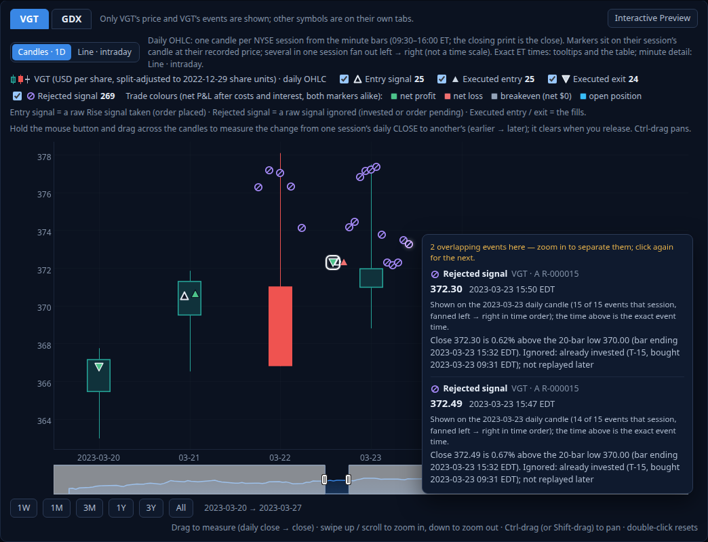
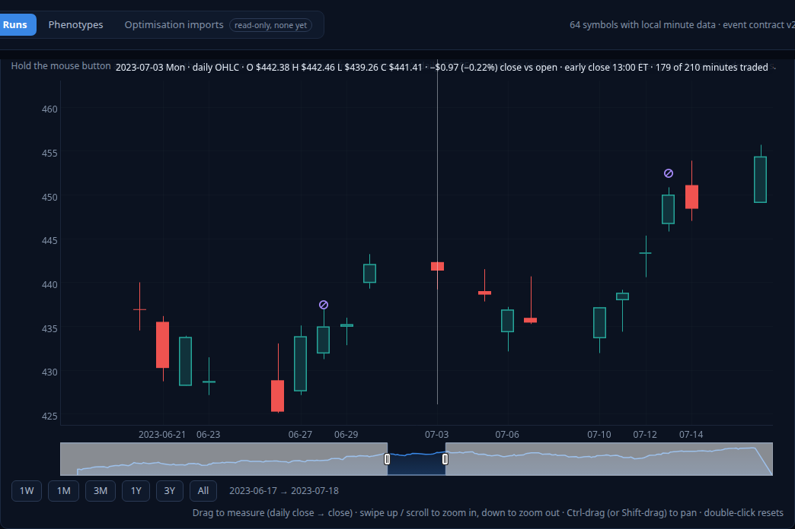
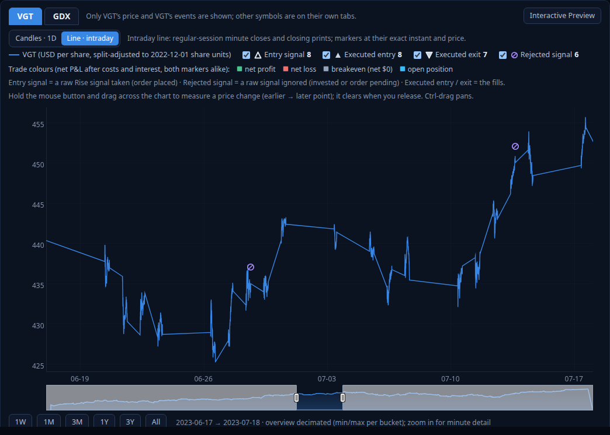
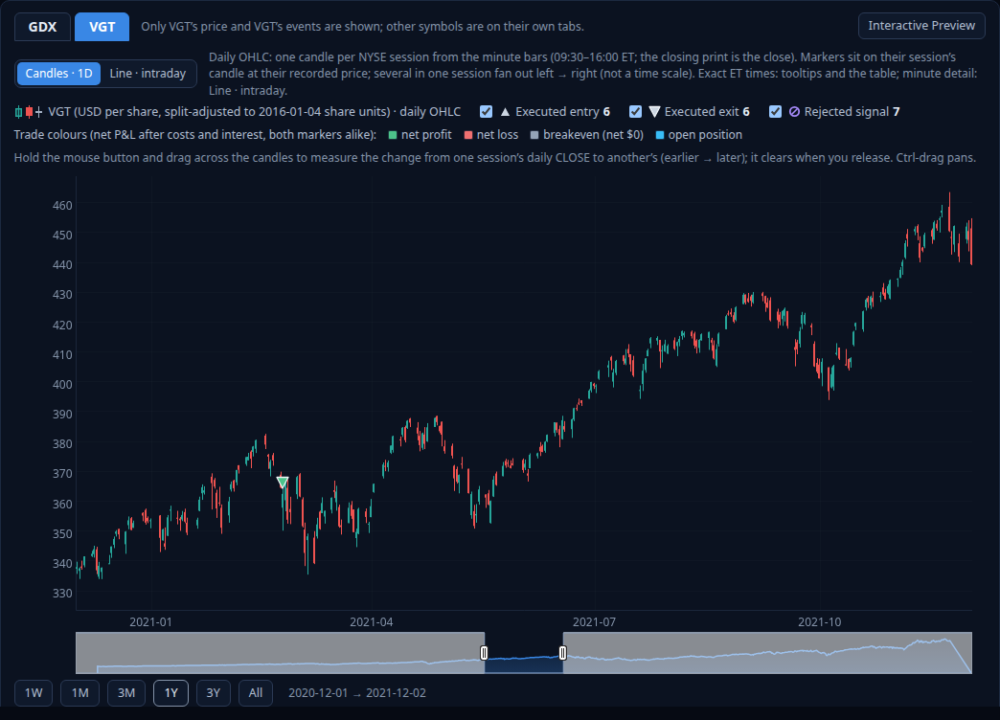
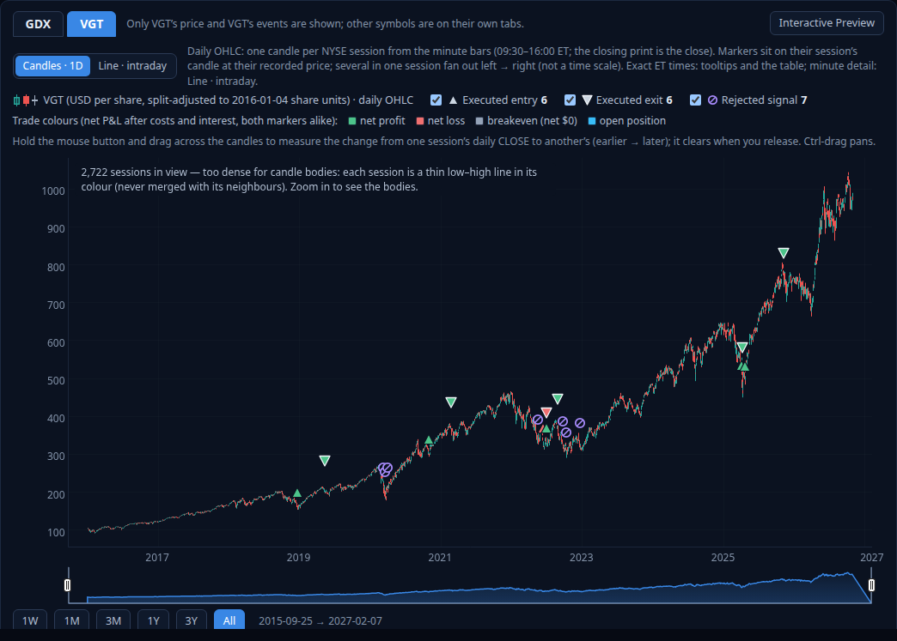

# Strategy Lab: daily OHLC candlestick chart — report (Task 16, 2026-11-06)

Brief: [`../../brief/2026-11-06-daily-ohlc-candlesticks-brief.md`](../../brief/2026-11-06-daily-ohlc-candlesticks-brief.md).
Feature documentation: [`../../DAILY_CANDLES.md`](../../DAILY_CANDLES.md). This is a presentation feature only: no
strategy, runner, execution, P&L, saved result, phenotype, schema or migration changed.

## What you see (user-facing)

A real run now opens on **Candles · 1D**: one daily candle per NYSE session.

- **Up days** (close above open) are hollow teal-green, **down days** solid red, and a **doji** (close equals open) a
  grey bar.
- Each candle has wicks to the day's actual high and low, from the minute bars' highs and lows.
- The y axis scales to those highs and lows.
- Hovering a candle shows its Eastern session date, O / H / L / C and the change close vs open.

Two buttons above the legend switch to **Line · intraday**, the existing minute chart, and back. Switching reruns
nothing and keeps the run, the symbol, the zoom, the selected event and the marker checkboxes. The synthetic demo
stays a line: it has no real open, high or low, and the candle button says why.

**Markers** keep their shapes, colours and toggles, their trade links, their P&L and their selection. On candles,
each sits on its New York session's candle at its recorded price, and several in one session fan out left → right
in time order. The tooltip and the table show the exact Eastern time. **Drag-to-measure** on candles runs from one
session's daily close to another's. Every other gesture works as before:

- ⌘/Ctrl-drag pans;
- a swipe up zooms in around the cursor;
- the buttons, the overview and double-click work as on the line.

## Screenshots (real data, Chrome)

Short window: one week of a 1-minute Growth run (VGT, 2023-03-20 → 03-27). The busiest session (2023-03-23) has
15 events fanned on its candle. The tooltip lists the two overlapping markers under the pointer with their exact
times and their place in the session:

One month of a daily Growth run (VGT 2023), the read-out on 2023-06-30:

The same window after switching to **Line · intraday** (the window is kept):

Long windows: the Study 8 vg-balanced import, VGT.

- One year: compact 2 px bodies.

  

- The full 2016–2026 history: 2,722 sessions, too dense for bodies. Each session is drawn as its own thin low–high
  line, and the chart says so. The units are split-adjusted to 2016-01-04, so the 2026 prices are × 8 after VGT's
  split.

  

## Design decisions

| Question | Decision |
| --- | --- |
| Data source | The repository's own session builder (`src/lib/session.ts`) on the canonical minute file, in the same cached load as the line (`server/prices.ts`). No second source, and no raw minutes in the browser |
| Open / high / low / close | First regular minute's open / max of minute highs and the closing print / min of minute lows and the closing print / the official closing print (else the last regular minute's close) |
| Closing print in the range | Yes, as in the session builder and every Growth rule. The 16:00 bar's own high and low (after-hours) are not counted |
| Units | One split factor per session for all four prices, to the run's basis (`basisDateOf`); preview and Study 8 imports use their own |
| Bad data | No candle; listed in `omitted` and shown as a warning. Untraded minutes are information, not errors |
| Candle x | The midpoint of the session's scheduled hours: a real instant, so both chart types share one time axis and a window carries over |
| Marker x | Its New York session's candle; several fanned left → right in canonical order (a fixed pixel step, not a time scale). Exact times stay in the data, tooltips and the table |
| Locating an event | Selecting it and "Zoom here" centre on its marker's x (on candles: its candle) |
| Dense windows | Below 2 px per day, each session is a thin low–high line. Never aggregated, and labelled |
| Measure | Daily close → close on candles, labelled. Minute points on the line (unchanged) |
| Chart type memory | Page state, like the checkboxes. No stored preference existed, so nothing was added (no migration) |
| Colours | `#26a69a` / `#ef5350` / `#a4b1c4`, validated against the chart surface (deutan ΔE 11.6, contrast ≥ 3:1); hollow vs solid as the non-colour cue |
| Library | Dygraphs kept: a custom plotter over four series (so autoscaling sees the highs and lows); the interaction model is unchanged |

## Verification

Times are UTC from the clock. Logs are in `apps/strategy-lab/logs/task16/` (git-ignored).

| Check | Result |
| --- | --- |
| `npm run check` (check-2, 16:29:36Z → 16:35:24Z, `check-2.log`) | typecheck (3 configs) and lint clean; **Vitest 281/281** (29 files: 244 existing + 22 `candles.test.ts` + 15 `candle-chart.test.ts`); build; **Playwright 74/74** in Chrome (64 existing + 10 `candles.spec.ts`); `dist` = this build |
| check-1 (16:28:48Z, `check-1.log`) | FAILED at typecheck: the Node tsconfig has no DOM types, and a test imported `drawCandle(ctx: CanvasRenderingContext2D)` → fixed with a structural `CandleContext` type |
| Full suites on a scratch build first (`full-1.log`) | Vitest 281/281; Playwright 72/74. Two regressions caused by the candles, both on the vg-balanced import, were **fixed in the product** (no edit to those tests): (1) two tests waited for the legend text "GDX (USD"; the candle legend now reads "GDX (USD per share, …) · daily OHLC"; (2) "Zoom here" centred on the entry's exact instant, which left the exit's candle just past the window's edge, so locating an event now centres on its marker's chart x. Rerun of candles, markers and trades: 22/22 (`e2e-rerun-1.log`) |
| Root `tsc` (`root-tsc.log`) | clean |
| Root ESLint (`root-eslint.log`) | 306 problems = the baseline (1 error: `src/study7-stability-first-d1/search.ts:310`, prefer-const, untouched); none in `apps/strategy-lab` |
| Root `npm test` | not run: no root source file changed (`git diff -- src/` is empty; the root change is README text only) |
| Real runs in the browser tests | a dense 1-minute Growth run (VGT 2023-02-01 → 04-28); the Study 8 **s8-vg-balanced** import (VGT and GDX, 2016 → 2026, dense mode, every recorded fill inside its own session candle's range); daily Growth runs (VGT; VGT+GDX); a comparison; an Interactive Preview |
| Network | candle mode makes exactly one `/candles` request per run and symbol and no `/prices` (minute line) request; switching back reuses it |
| Size and speed | VGT 2016-01-04 → 2026-10-30: 2,723 candles, 183 KB JSON; slicing and adjusting about 0.4 ms once loaded; the symbol's first load (shared with the line) about 2–3 s |
| Saved results | the e2e test reads run detail and events before and after viewing on candles: identical. The server test hashes the state directory around the candle requests: database and WAL byte-identical |
| Live state | `state/strategy-lab/` (131 files, preview cache excluded) byte-identical to the pre-task baseline; no file newer than it |
| Market data | VGT `2ee06310…`, GDX `77dba9b2…`, XBI `4a51bcbe…`, unchanged |
| Engine | no diff in `src/`, `apps/strategy-lab/runner/`, `shared/strategies.ts`, `shared/contract.ts` or `config/`; the Interactive Preview's implementation fingerprint (the runners' import closure) is unaffected |

## Disclosures

1. **Test edits.**
   - `e2e/helpers.ts`: `tradingRun` gained an optional `resolution` (default `1d`, unchanged), and a new
     `chooseChart` helper was added.
   - Three existing real-data tests now choose **Line · intraday** first, because they test the MINUTE line:
     strategy-lab.spec "crosshair … Eastern-time readout" and "entry times match the source to the minute", and
     measure.spec "Eastern date-times on vg-balanced".
   - No other existing test was changed. Every other existing real-data test now runs on candles by default, which
     covers tone, trade selection, links, P&L, comparison and preview behaviour on candles.
2. **Behaviour change on candles only.** Selecting an event and "Zoom here" centre on its marker's x, its session's
   candle. The line is unchanged.
3. **Browser coverage.**
   - Chrome on Linux only (Playwright `channel: chrome`), with synthetic wheel events; no Safari, Firefox or real
     trackpad.
   - ⌘-drag on candles is not exercised on macOS. The interaction model is shared and unchanged, and its ⌘ path is
     covered by the existing pan.spec on the line (emulated macOS platform).
4. **State-hash test.** It excludes SQLite's `-shm` shared-memory index: any reader writes its read marks there, and
   it holds no data. The database file and the WAL are hashed.
5. **Limitations.**
   - Day resolution: the fan shows only intraday order, not a time scale.
   - Below 2 px per day, sessions are overlapping thin low–high lines (labelled).
   - Bodies under 5 px are solid in both directions (colour cue only).
   - A doji is exact equality.
   - Volume is not shown.
   - The chart type is not remembered across page loads (no stored preference existed; the brief excludes a
     migration).
6. **Data read.** The tests and screenshots read the real VGT, GDX and XBI files, including 2024–2026 (the
   vg-balanced window and VGT's 2026-04-21 split). The app already displays these dates. No research study or data
   embargo is involved.
7. **Earlier records.** The Task 15 checkpoint attributed root ESLint's single error to
   `src/trailing-buy-variants/selection.ts`. This run locates it at `src/study7-stability-first-d1/search.ts:310`
   (the count of 306 is the same).
8. **Flaky test.** The known-flaky `strategy-lab.spec.ts` symbol-switch test passed in both full runs.
9. **To see it.** The user's live server was not running during the task. Start it the usual way
   (`npm --prefix apps/strategy-lab run start:vpn`); `dist` is this build. No migration is needed.
