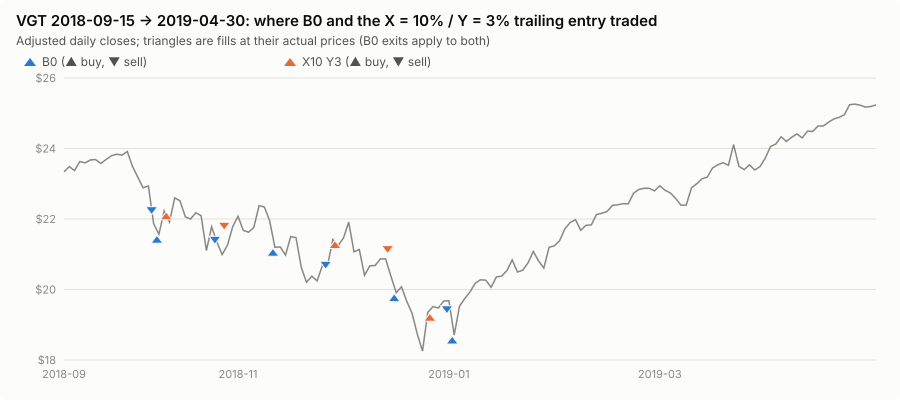
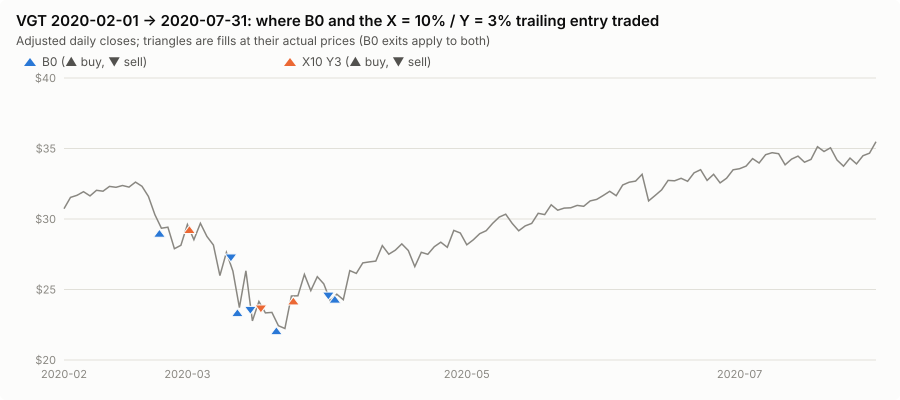
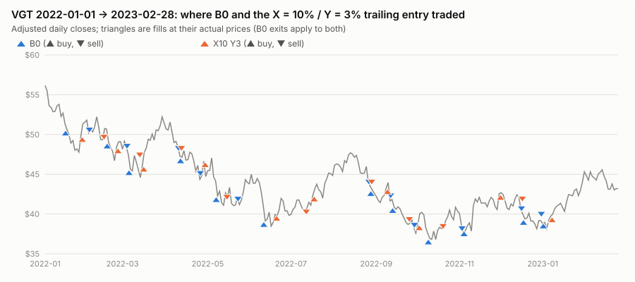
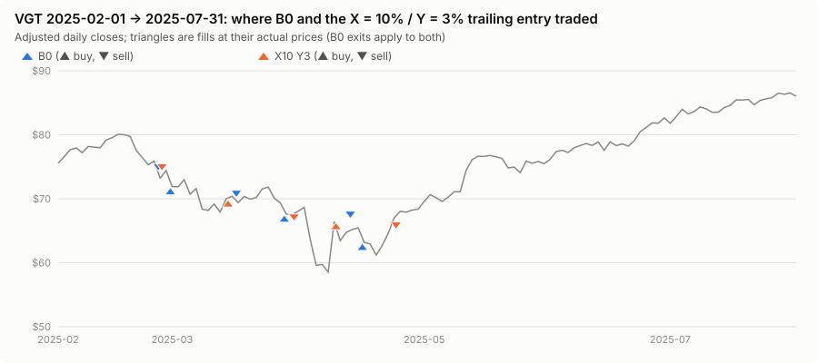
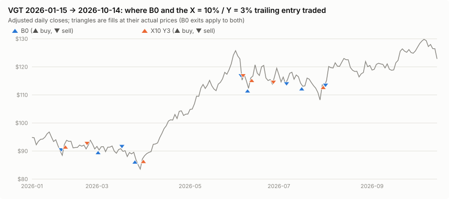

# Event attribution: which corrections a delayed entry helps

**Result: across the 20 VGT corrections of 2014–2026, a trailing rebound entry at the original 10% arm level was better than the immediate entry in a minority of episodes of every type: shallow or deep, fast or gradual, V-shaped or with failed rallies.** The brief's motivating case, a 20–30% sell-off that a delayed entry would partly sit out, is exactly where it did worst. Its first purchase usually came on an early bounce that failed, and the 15-day loss exit then sold it near the lows. Deeper *immediate* entries (X ≈ 15–20%) did help in the gradual 2018 Q4 and 2022 declines; adding a rebound condition on top took most of that back.

## Method

Episodes are segmented by a fixed, price-only rule registered in PROTOCOL.md §10 (start: first close ≥ 10% below the highest high of the previous 90 sessions; end: first close ≥ 95% of that frozen reference high). Fast = trough within 25 sessions of the reference-high session; V = recovered within 40 sessions of the trough; failed rallies = ≥ 3% bounces from the running low that were followed by a new low before the trough. The segmentation uses future prices *to describe* events and is never an input to a trading decision. P&L is attributed by **block**, from an episode's start to the session before the next one starts, using continuous mark-to-market runs. That way trades crossing an episode boundary are counted where they earned, and nothing is closed artificially.

This is post-holdout, explanatory analysis. Nothing here was used to select or tune anything, and the configurations below are fixed, intuitive settings plus the frozen picks. The 2020 and 2025 events are widely publicized and known to the researcher, and the holdout period was already studied by `research/vgt-drawdown-entry-risk`. Their value as untouched tests is limited (PROTOCOL.md §3).

## The 20 episodes (2014-01-02 → 2026-10-14)

| Start | Reference high | Trough | Depth | Descent | Speed | Shape | Failed rallies | Recovered | Period |
| --- | ---: | ---: | ---: | ---: | --- | --- | ---: | ---: | --- |
| 2015-08-21 | $12.53 | 2015-08-25 | 14.3% | 26 | gradual | V | 0 | 2015-10-09 | development |
| 2016-01-07 | $12.83 | 2016-02-09 | 16.6% | 46 | gradual | V | 1 | 2016-03-17 | development |
| 2018-02-08 | $20.88 | 2018-02-08 | 10.3% | 9 | fast | V | 0 | 2018-02-14 | development |
| 2018-04-02 | $21.72 | 2018-04-02 | 10.3% | 13 | fast | V | 0 | 2018-04-17 | development |
| **2018-10-11** | $24.02 | 2018-12-24 | **24.0%** | 56 | gradual | slow | 4 | 2019-02-25 | development |
| 2019-06-03 | $25.52 | 2019-06-03 | 11.5% | 22 | fast | V | 0 | 2019-06-07 | development |
| **2020-02-25** | $32.68 | 2020-03-23 | **32.0%** | 23 | fast | slow | 4 | 2020-05-29 | development |
| 2020-09-08 | $40.94 | 2020-09-23 | 12.9% | 14 | fast | V | 1 | 2020-10-09 | development |
| 2020-10-28 | $40.94 | 2020-10-30 | 12.3% | 41 | gradual | V | 0 | 2020-11-05 | development |
| 2021-03-04 | $46.19 | 2021-03-08 | 11.3% | 14 | fast | V | 0 | 2021-04-01 | development |
| **2022-01-19** | $56.78 | 2022-10-14 | **35.2%** | 201 | gradual | slow | 9 | 2023-06-15 | development |
| 2023-09-21 | $56.96 | 2023-10-26 | 13.5% | 70 | gradual | V | 1 | 2023-11-10 | holdout |
| 2024-04-19 | $66.28 | 2024-04-19 | 10.4% | 29 | gradual | V | 0 | 2024-05-03 | holdout |
| 2024-08-01 | $75.51 | 2024-08-07 | 15.5% | 17 | fast | V | 0 | 2024-08-19 | holdout |
| 2024-09-04 | $75.51 | 2024-09-06 | 12.5% | 38 | gradual | V | 0 | 2024-09-19 | holdout |
| **2025-03-03** | $80.65 | 2025-04-08 | **27.4%** | 51 | gradual | V | 1 | 2025-05-14 | holdout |
| 2025-11-20 | $100.67 | 2025-11-20 | 11.3% | 16 | fast | V | 0 | 2025-12-05 | holdout |
| 2026-02-04 | $100.67 | 2026-03-30 | 17.0% | 103 | gradual | V | 1 | 2026-04-14 | holdout |
| 2026-06-10 | $126.00 | 2026-06-10 | 10.8% | 5 | fast | V | 0 | 2026-06-15 | holdout |
| 2026-07-17 | $126.00 | 2026-07-29 | 14.1% | 38 | gradual | V | 0 | 2026-08-04 | holdout |

In 6 of the 20 episodes the first 10% close was itself the episode's closing low, and in 5 more the low came within four sessions. Only four declines went 20% or deeper. The independent sample is small: conclusions below are descriptive, with the event-level bootstrap in VALIDATION_ROBUSTNESS.md quantifying the uncertainty.

## Grouped attribution against B0 (2014–2026; Σ block P&L difference, blocks better than B0 / blocks)

| Run | 10–15% deep | 15–20% | 20–25% | ≥ 25% | fast | gradual | V-shaped | slow (failed rallies) |
| --- | ---: | ---: | ---: | ---: | ---: | ---: | ---: | ---: |
| X10 Y1 | −$45,459 (1/13) | +$57,023 (2/3) | −$18,764 (0/1) | −$79,369 (0/3) | −$38,410 (1/9) | −$48,159 (2/11) | +$4,910 (3/17) | −$91,479 (0/3) |
| X10 Y2 | −$33,481 (2/13) | +$736 (2/3) | −$9,617 (0/1) | −$76,752 (0/3) | −$39,424 (1/9) | −$79,690 (3/11) | −$75,492 (4/17) | −$43,622 (0/3) |
| X10 Y3 | −$55,166 (1/13) | +$4,770 (3/3) | −$948 (0/1) | −$87,548 (0/3) | −$41,683 (1/9) | −$97,209 (3/11) | −$93,143 (4/17) | −$45,750 (0/3) |
| X10 Y5 | −$71,261 (2/13) | +$5,432 (1/3) | −$1,983 (0/1) | −$114,822 (0/3) | −$48,585 (1/9) | −$134,050 (2/11) | −$95,861 (3/17) | −$86,773 (0/3) |
| X15 Y2 | −$68,966 (3/13) | +$32,912 (2/3) | +$3,818 (1/1) | −$67,308 (0/3) | −$32,324 (3/9) | −$67,220 (3/11) | −$78,801 (5/17) | −$20,743 (1/3) |
| X20 Y2 | −$67,107 (3/13) | −$18,614 (2/3) | +$4,632 (1/1) | −$84,300 (0/3) | −$34,628 (3/9) | −$130,762 (3/11) | −$122,748 (5/17) | −$42,642 (1/3) |
| X15 immediate | −$69,024 (3/13) | +$41,433 (2/3) | +$4,847 (1/1) | −$56,824 (1/3) | −$33,582 (3/9) | −$45,986 (4/11) | −$69,102 (5/17) | −$10,466 (2/3) |
| ATR X10 K2.0 N14 | −$68,110 (2/13) | +$2,360 (1/3) | −$3,811 (0/1) | −$106,394 (0/3) | −$55,756 (1/9) | −$120,199 (2/11) | −$102,776 (3/17) | −$73,179 (0/3) |
| P1.balanced (X10 Y1.9) | −$33,481 (2/13) | +$54,272 (2/3) | −$9,617 (0/1) | −$76,752 (0/3) | −$39,424 (1/9) | −$26,154 (3/11) | −$21,956 (4/17) | −$43,622 (0/3) |
| P2xy.balanced (X15.4 Y1.9) | −$68,966 (3/13) | +$32,912 (2/3) | +$3,818 (1/1) | −$54,676 (0/3) | −$22,754 (3/9) | −$64,157 (3/11) | −$78,801 (5/17) | −$8,111 (1/3) |
| P4.legacy.balanced | +$6,090 (3/13) | +$55,539 (1/3) | +$3,219 (1/1) | +$8,152 (3/3) | +$5,943 (3/9) | +$67,057 (5/11) | +$63,662 (5/17) | +$9,338 (3/3) |
| P4.fixed.balanced | −$31,966 (4/13) | +$30,275 (1/3) | +$1,726 (1/1) | −$119,464 (0/3) | −$53,561 (2/9) | −$65,869 (4/11) | −$50,333 (5/17) | −$69,097 (1/3) |
| P4.atr.balanced | −$35,842 (4/13) | +$41,052 (2/3) | −$1,227 (0/1) | −$77,686 (0/3) | −$7,645 (4/9) | −$66,058 (2/11) | −$31,816 (6/17) | −$41,887 (0/3) |

(Full per-episode rows: `results/events/episode_attribution_2014_2026.csv`. 2014–2022 is in sample for the P-rows; the P4.legacy row is the re-optimized *immediate* entry, positive here because its parameters were fitted on 2014–2022, while its 2023–2026 holdout result is −$7,293 vs B0.)

- **Shallow 10–15% dips (13 episodes):** every trailing variant loses; it beats B0 in at most 4 of 13. These dips mostly bottom at or near the arming close, so a rebound condition just buys higher.
- **15–20% (3 episodes):** the only positive class, carried by the 2016 correction's long trade (+$55k for Y = 1%); a path artifact rather than an edge (PHASE1_FIXED_Y.md).
- **20–25% (2018 Q4) and ≥ 25% (2020, 2022, 2025):** no trailing variant at X = 10% beats B0 in any of the four. Deeper arm levels help in 2018 Q4 (gradual, four failed rallies), and a deeper *immediate* entry helps in 2022. None helps in 2020 or 2025.
- **V-shaped vs failed rallies:** the trailing entry loses in both. In V's it buys after part of the rebound has gone. With failed rallies it buys the rally that fails.

## The four deep corrections in detail

| Episode | Run | B0 first buy | Run first buy | vs B0 buy | above the trough | B0 block P&L | Run block P&L | Difference |
| --- | --- | --- | --- | ---: | ---: | ---: | ---: | ---: |
| 2018-10-11 (24.0%, gradual, 4 failed rallies) | X10 Y3 | 2018-10-11 $21.57 | 2018-10-12 $22.23 | +3.1% | +21.8% | $12,495 | $11,547 | −$948 |
| | X15 Y2 | | 2018-11-26 $20.68 | −4.1% | +13.3% | | $16,313 | +$3,818 |
| | X20 Y2 | | 2018-12-26 $19.35 | −10.3% | +6.0% | | $17,127 | +$4,632 |
| 2020-02-25 (32.0%, fast, 4 failed rallies) | X10 Y3 | 2020-02-25 $29.35 | 2020-03-02 $29.61 | +0.9% | +33.2% | $44,155 | $26,661 | −$17,494 |
| | X15 Y2 | | 2020-03-10 $27.63 | −5.8% | +24.3% | | $27,737 | −$16,419 |
| | ATR K2.0 N14 | | 2020-03-02 $29.61 | +0.9% | +33.2% | | $17,720 | −$26,435 |
| 2022-01-19 (35.2%, gradual, 9 failed rallies) | X10 Y3 | 2022-01-19 $50.63 | 2022-01-28 $49.82 | −1.6% | +35.4% | $24,045 | −$3,262 | −$27,307 |
| | X15 immediate | | 2022-01-25 $48.03 | −5.1% | +30.6% | | $29,697 | +$5,652 |
| | X20 Y2 | | 2022-03-15 $46.09 | −9.0% | +25.3% | | −$6,810 | −$30,856 |
| 2025-03-03 (27.4%, gradual, V) | X10 Y3 | 2025-03-03 $71.89 | 2025-03-14 $69.99 | −2.7% | +19.5% | $34,557 | −$8,189 | −$42,747 |
| | X20 Y2 | | 2025-04-09 $66.44 | −7.6% | +13.5% | | −$2,469 | −$37,026 |
| | P4.legacy.balanced | | 2025-04-03 $63.66 | −11.4% | +8.7% | | $36,591 | +$2,033 |

**Did the deep corrections favour delayed entries? No.** A delayed *first* entry was sometimes cheaper (2022, 2025). But the block P&L depends on the whole sequence of entries and forced exits, and there the trailing rule was worse in every deep episode at X = 10%. The two clearest cases (verified from the trade lists):

- **March 2020 (fast).** Y = 3% armed on 2020-02-25 and bought the 2020-03-02 bounce at $29.61, above B0's $29.35 entry. The 15-day exit sold it on 2020-03-17 at $23.27 (−$21,876, against B0's first loss of −$8,847). It then re-entered on 2020-03-24 at $24.54 (a restricted entry the day after the low) and captured the recovery to 2020-09-04 (+$48,537). It did catch the recovery, but only after a first loss 2.5× B0's.
- **April 2025 (V).** Y = 3% armed on 2025-03-03 and bought the 2025-03-14 bounce at $69.99; the 15-day exit sold it at $66.34 (−$5,721). Restricted, it re-armed on 2025-04-03 at $63.66 with a trough of $58.54 on 2025-04-08. It then bought the +13.5% tariff-pause session, 2025-04-09, at **$66.44**: the actual close, 10% above the $60.30 trigger. That position was also sold on day 15 (2025-04-24, $65.10, −$2,469), and the strategy did not trade again until November. B0 meanwhile bought 2025-04-16 at $63.20 and held to 2025-11-14 at $92.09 (+$39,335). **The rebound rule captured none of the V recovery.**

The pattern in both: the trailing buy fills *on* a strong up-close (the rebound is the signal). After a strong up-close, VGT's next 15 calendar days were often flat or lower, which the unchanged maximum-hold rule turns into a forced loss. The immediate entry buys on down-closes and is more often above water by day 15.

## Entry traces

Fills at their actual prices, B0 (blue) vs X = 10% / Y = 3% (orange):

## Named events (out of sample where possible)

Development events use each walk-forward fold's own pick, scored out of sample (`results/validation/development/tables.md`); holdout events use the frozen FINAL picks (`results/holdout/tables.md`). MTM P&L / drawdown inside each window:

| Run | 2018 Q4 (WF1 pick) | 2020 Feb–Jun (WF2 pick) | 2022 (WF3 pick) | early 2025 | 2026 H1 | 2026 H2 |
| --- | ---: | ---: | ---: | ---: | ---: | ---: |
| **B0** | $13,209 / $23,532 | $29,204 / $14,403 | −$4,758 / $21,887 | $15,447 / $25,713 | $30,577 / $12,592 | −$7,391 / $16,344 |
| P1.balanced | −$6,406 / $26,425 | $19,575 / $15,853 | −$22,059 / $29,493 | −$16,261 / $22,663 | $29,887 / $7,481 | −$9,032 / $20,959 |
| P2xy.balanced | $5,115 / $16,806 | $11,621 / $23,751 | −$22,059 / $29,493 | −$8,189 / $16,254 | $0 / $0 | $0 / $0 |
| P3snap.balanced | $5,115 / $16,806 | $7,695 / $11,117 | −$2,612 / $18,435 | $16,943 / $4,077 | $29,498 / $4,123 | −$6,168 / $11,474 |
| P4.legacy.balanced | $18,619 / $16,277 | −$19,496 / $28,084 | −$16,338 / $21,882 | $26,216 / $15,966 | $32,719 / $11,945 | −$9,767 / $17,767 |
| P4.fixed.balanced | $10,791 / $23,023 | −$21,235 / $30,998 | −$22,873 / $28,477 | −$14,084 / $17,754 | $20,443 / $5,491 | −$6,273 / $10,167 |
| P4.atr.balanced | $10,791 / $23,023 | −$17,490 / $25,176 | −$25,688 / $28,088 | −$2,469 / $8,236 | $29,498 / $4,123 | −$6,714 / $12,019 |
| P4.atr.lowDD | $6,159 / $4,261 | −$3,426 / $10,229 | −$3,345 / $14,842 | $21,311 / $4,226 | $29,498 / $4,123 | −$3,047 / $8,133 |

(Phase 4 rows use the corrected walk-forward picks of PHASE4_OPTIMIZATION.md; each event column is the MTM change inside that event window only, so it differs from the whole-fold validation figures.) A few candidates have shallower drawdowns inside particular events (P3snap.balanced and P4.atr.lowDD in early 2025 and 2026 H1). They get there by holding little through the event, and they do not make more money than B0 in the events that pay (2020, early 2025), with one exception: P4.atr.lowDD earned $21.3k in early 2025 vs B0's $15.4k with a $4.2k drawdown. Across all windows, though, its walk-forward and holdout totals fail against B0 (VALIDATION_ROBUSTNESS.md).

## Conclusion

The corrections where a delayed entry was supposed to help (deep, extended sell-offs) are where the trailing rebound entry lost most. It buys strong up-closes, which in VGT's deep declines were mostly failed rallies (2020, 2022) or a single overshooting day (2025-04-09). The unchanged 15-day loss exit then sells those fills near the lows. The immediate entry is "early" by 7–8% on average, but its exits and re-entries recover from that; the delayed entry's errors compound instead.
