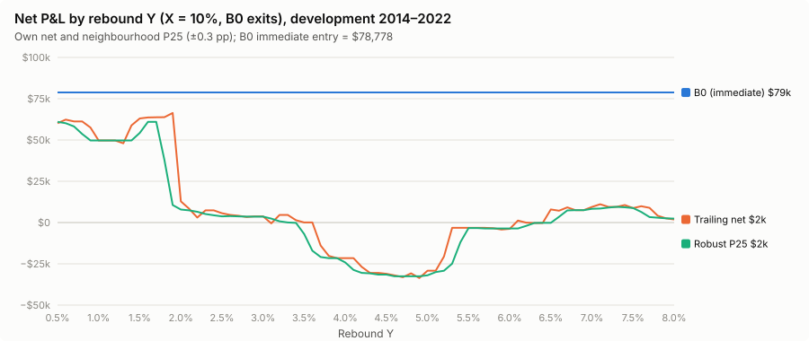
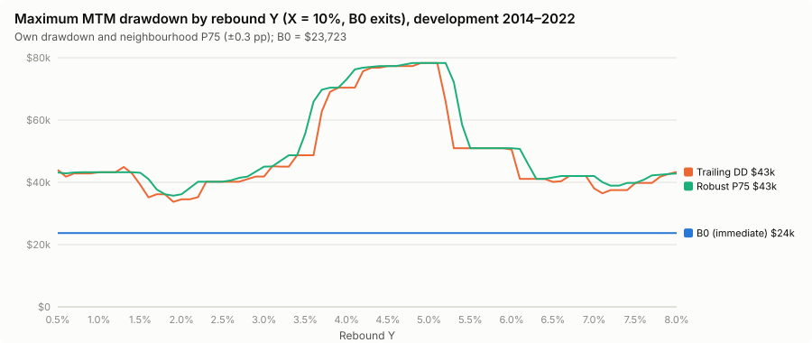
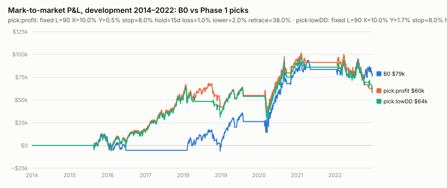

# Phase 1: the trailing rebound Y at X = 10%

**Result: no value of Y helps.** With the arm level at 10% and every exit and re-entry setting at B0, all 76 values of Y from 0.5% to 8.0% earn less than the immediate entry on the 2014–2022 development period, and every one has a deeper mark-to-market drawdown. The walk-forward picks keep $10k of B0's $84k validation profit with a drawdown 24–69% deeper. The mechanism is simple: at a 10% arm level VGT's corrections usually bottom near the arming close, so waiting for a Y% rebound mostly means buying higher. The higher entry then trips the unchanged 15-day loss exit more often.

Setup (PROTOCOL.md §6): X = 10.0%, L = 90, stop 8.0%, hold 15 days, material loss 1.0%, lower re-entry 2.0%, retrace 38.0%, 11% interest, same-close fills. Y = 0.5% … 8.0% in 0.1-pp steps; the 0.5-pp points are the initial sweep, and the full 0.1-pp grid is the refinement, run everywhere rather than only near a chosen region. Neighbourhood for the robust statistics: ±0.3 pp in Y. Results: `results/phase1/`.

## Development period, 2014-01-02 → 2022-12-30 (training window of the FINAL fold)

| Run | Net | Max DD | Interest | Entries | Win rate | In market | Setups | Cancelled | Pending at end | Mean wait (sessions) | Worst open-trade mark |
| --- | ---: | ---: | ---: | ---: | ---: | ---: | ---: | ---: | ---: | ---: | ---: |
| **B0 (immediate)** | **$78,778** | **$23,723** | $43,066 | 30 | 45% | 43.7% | – | – | – | – | −$11,840 |
| Y=0.5% | $60,141 | $44,011 | $56,447 | 27 | 35% | 57.1% | 27 | – | – | 2.2 | −$16,110 |
| Y=1.0% | $49,708 | $43,238 | $51,052 | 27 | 31% | 51.6% | 27 | – | – | 2.3 | −$23,507 |
| Y=1.5% | $63,055 | $39,180 | $51,866 | 27 | 31% | 52.4% | 27 | – | – | 2.7 | −$23,507 |
| Y=2.0% | $12,808 | $34,546 | $31,493 | 27 | 27% | 32.0% | 27 | – | – | 3.4 | −$23,507 |
| Y=2.5% | $5,665 | $40,211 | $30,288 | 25 | 29% | 30.7% | 25 | – | – | 4.2 | −$23,507 |
| Y=3.0% | $3,743 | $41,866 | $29,956 | 24 | 29% | 30.4% | 25 | – | 1 | 4.5 | −$23,507 |
| Y=3.5% | $54 | $48,685 | $28,510 | 23 | 26% | 28.9% | 24 | – | 1 | 5.6 | −$23,507 |
| Y=4.0% | −$21,556 | $70,403 | $27,244 | 23 | 22% | 27.6% | 24 | – | 1 | 6.0 | −$23,507 |
| Y=4.5% | −$31,046 | $77,339 | $27,153 | 23 | 22% | 27.5% | 24 | – | 1 | 6.3 | −$23,507 |
| Y=5.0% | −$29,194 | $78,315 | $30,016 | 23 | 17% | 30.5% | 24 | – | 1 | 7.6 | −$23,507 |
| Y=5.5% | −$3,204 | $50,946 | $29,504 | 20 | 20% | 29.9% | 21 | – | 1 | 9.3 | −$23,507 |
| Y=6.0% | −$3,803 | $50,509 | $29,444 | 20 | 15% | 29.8% | 21 | – | 1 | 9.5 | −$23,507 |
| Y=6.5% | $7,919 | $40,134 | $25,616 | 19 | 11% | 25.8% | 20 | – | 1 | 12.3 | −$15,853 |
| Y=7.0% | $9,451 | $38,070 | $26,099 | 20 | 10% | 26.2% | 21 | – | 1 | 14.1 | −$15,853 |
| Y=7.5% | $8,732 | $39,804 | $23,567 | 19 | 11% | 23.5% | 21 | 1 | 1 | 15.4 | −$15,853 |
| Y=8.0% | $1,869 | $43,334 | $17,962 | 15 | 13% | 18.3% | 16 | 1 | – | 20.9 | −$15,853 |

"Pending at end" is a setup still waiting at 2022-12-30; "cancelled" is a setup cancelled by a recovery reset. With no max-wait expiry, a setup always fills eventually except in those cases. Full 0.1-pp results: `results/phase1/grid_FINAL.csv`; every run's trades and setups: `development_trades.csv`, `development_setups.csv`.

The fine grid has no plateau above B0. The best stretch is Y ≈ 0.5–1.9% (own net $50–66k), and even its robust 25th-percentile net falls to $10–61k. Drawdowns are $33–44k throughout, against B0's $23.7k.

## Why it loses: the trailing entry mostly buys higher

Over the development setups (`development_setups.csv`):

| Y | Setups | Further decline after arming, mean (median) | Fill vs the arming close, mean (median) | Fills above the arming close | Trough on the arming close itself | Median wait |
|---|---:|---:|---:|---:|---:|---:|
| 0.5% | 27 | 1.4% (0.0%) | +0.9% (+1.4%) | 74% | 14 / 27 | 2 sessions |
| 1.0% | 27 | 1.3% (0.0%) | +1.4% (+1.5%) | 81% | 14 / 27 | 2 |
| 2.0% | 27 | 1.8% (0.9%) | +1.5% (+1.4%) | 78% | 9 / 27 | 2 |
| 3.0% | 25 | 2.3% (1.0%) | +2.1% (+2.7%) | 83% | 8 / 25 | 3.5 |
| 5.0% | 24 | 2.5% (1.9%) | +3.5% (+3.9%) | 91% | 4 / 24 | 6 |
| 8.0% | 16 | 5.8% (5.2%) | +2.3% (+2.7%) | 73% | 4 / 16 | 18 |

- **The decline the rule waits out is small.** Once VGT closes 10% below its 90-session high, the median further fall in closing prices before a Y% bounce is 0–2%, and in about half the setups at small Y the arming close *was* the low. The rebound the rule demands is larger than the decline it avoids, so most fills cost more than the immediate entry. Example: 2018-02-08, armed at $18.73 (the low); 2018-02-09 closed at $19.18, below the $19.29 trigger; the buy came on 2018-02-12 at $19.52, 4.2% above B0's entry.
- **A higher entry trips the 15-day loss exit.** The maximum-hold rule sells at the open after 15 days if the position is under water. Buying a few percent higher turns sideways consolidations into forced losing exits. Example: April 2018. B0 bought on 2018-04-02 at $19.49 and rode the rally to a stop exit at $22.09 (+$7,610). Y = 3% bought on 2018-04-10 at $20.14 and was sold on day 15 (2018-04-25) at the $19.80 open (−$2,133).
- **In the 2022 bear market it buys the rallies that fail.** That episode alone costs −$24k (Y = 3%) to −$26k (Y = 0.5%) relative to B0, which lost only −$4.8k there.
- **Losses repeat through the restriction.** After a material loss, the lower level now gives permission to arm, and under variant A the rebound fill can be above it. That re-entry is dearer than the original lower-price entry.

### Per-episode attribution (blocks from each episode's start to the next one's)

| Run | Blocks better than B0 | Σ block difference | Mean entry vs B0's entry | Mean B0 entry → trough | Mean entry above trough | Trades disappeared | Trades appeared |
| --- | ---: | ---: | ---: | ---: | ---: | ---: | ---: |
| Y=0.5% | 1 / 11 | −$18,637 | +1.0% | −7.3% | +10.1% | 0 | 0 |
| Y=1.0% | 1 / 11 | −$29,070 | +1.7% | −7.3% | +11.0% | 0 | 0 |
| Y=2.0% | 1 / 11 | −$65,970 | +1.6% | −7.3% | +10.9% | 0 | 0 |
| Y=3.0% | 1 / 11 | −$75,035 | +2.2% | −7.3% | +11.5% | 0 | 0 |
| Y=5.0% | 2 / 11 | −$107,972 | +3.7% | −7.3% | +13.1% | 0 | 0 |
| Y=8.0% | 1 / 11 | −$76,909 | +2.3% | −7.3% | +16.5% | 4 | 0 |

"Mean B0 entry → trough" is how far the episode's lowest close lay below B0's first entry (B0 is early by 7.3% on average); "entry above trough" is how far above that low each rule's first entry was. The trailing entry does not get closer to the bottom: its first entry is on average 1–4% *dearer* than the immediate one. The single block where small Y wins is the 2016 correction: a later 2016 entry happened to begin the long 2016–2018 trade, a known knife-edge path (the prior study `research/vgt-drawdown-entry-risk` found the same trade drives most in-sample gains). Per-episode rows: `development_episode_attribution.csv`.

## Walk-forward (each fold's own pick, scored on the next window)

| Fold | Pick | Parameters | Training net | Training DD | Robust net (P25) | Robust DD (P75) |
| --- | --- | --- | ---: | ---: | ---: | ---: |
| WF1 (2014–2017) | profit = balanced = lowDD | Y = 0.8% | $52,137 | $16,647 | $52,137 | $16,647 |
| WF2 (2014–2019) | profit = lowDD | Y = 0.7% | $54,942 | $26,623 | $54,942 | $26,623 |
| WF2 | balanced (fallback) | Y = 7.7% | $1,352 | $23,751 | −$1,635 | $23,751 |
| WF3 (2014–2021) | profit = lowDD | Y = 0.6% | $91,203 | $33,024 | $91,203 | $33,024 |
| WF3 | balanced (fallback) | Y = 7.4% | $32,642 | $25,999 | $31,234 | $25,999 |
| FINAL (2014–2022) | profit | Y = 0.5% | $60,141 | $44,011 | $60,989 | $43,162 |
| FINAL | balanced (fallback) | Y = 1.9% | $66,344 | $33,733 | $10,607 | $35,698 |
| FINAL | lowDD | Y = 1.7% | $63,737 | $36,186 | $60,956 | $37,683 |

"Fallback" means no point's robust drawdown was within B0's, so the rule took the lowest robust drawdown (PROTOCOL.md §7). B0's training results per fold: WF1 −$5,405 / $18,785, WF2 $26,296 / $23,723, WF3 $83,536 / $23,723.

| Pick | WF1 2018–19 net / DD | WF2 2020–21 net / DD | WF3 2022 net / DD | Σ net | Worst DD | Class vs B0 | Flat start Σ net / worst DD |
| --- | ---: | ---: | ---: | ---: | ---: | ---: | ---: |
| **B0** | $31,701 / $23,723 | $57,240 / $15,660 | −$4,758 / $21,887 | **$84,183** | **$23,723** | – | $84,183 / $23,723 |
| profit | $2,804 / $26,623 | $36,261 / $25,223 | −$28,877 / $40,189 | $10,189 | $40,189 | Fails | $13,389 / $40,189 |
| balanced | $2,804 / $26,623 | $29,529 / $15,853 | −$22,059 / $29,493 | $10,274 | $29,493 | Fails | $13,474 / $29,493 |
| lowDD | $2,804 / $26,623 | $36,261 / $25,223 | −$28,877 / $40,189 | $10,189 | $40,189 | Fails | $13,389 / $40,189 |

## Sensitivities (development, all on the 0.1-pp Y grid)

| Variant | Its baseline net / DD | Y = 3.0% net / DD | Primary Y = 3.0% net / DD | Best-profit point | Lowest-DD pick |
| --- | ---: | ---: | ---: | ---: | ---: |
| Restricted fill **B** (lower level also at fill) | $78,778 / $23,723 | −$15,485 / $45,917 | $3,743 / $41,866 | Y=0.6%: $59,622 / $32,752 | same |
| Frozen high = fill session's | $78,778 / $23,723 | $3,743 / $41,866 | $3,743 / $41,866 | Y=0.5%: $60,141 / $44,011 | Y=1.7%: $63,737 / $36,186 |
| B0c exits (0.5% / 3%) | $72,993 / $23,723 | $3,743 / $41,866 | $3,743 / $41,866 | Y=0.5%: $69,632 / $33,024 | same |
| Optional max-wait 10 sessions | $78,778 / $23,723 | −$8,890 / $46,293 | $3,743 / $41,866 | Y=0.5%: $60,141 / $44,011 | Y=1.7%: $63,737 / $36,186 |
| Optional max-wait 20 / 40 sessions | $78,778 / $23,723 | $3,743 / $41,866 | $3,743 / $41,866 | unchanged | unchanged |

- **Variant B vs A.** Requiring the lower level at fill time as well makes Y = 3% worse (−$15k): it postpones restricted re-entries until a lower trough, which in 2022 meant buying later rallies. A remains the primary reading. Under A, restricted fills above the frozen lower level do occur: that is the semantic change from the original's lower-price *execution* rule.
- **Frozen reference high.** Using the fill session's rolling high instead of the activation high changes nothing on development. It matters only when a restricted episode's reset level would differ, which the independent replay found happens once (2022-09) without changing any trade.
- **Max-wait expiry** (an optional new rule, not adopted) only matters at 10 sessions, where it makes things worse.
- **B0c exits.** With the checked-in 0.5% / 3% restriction the picture is the same: no Y beats its own baseline.

## Conclusion

At X = 10% the primary hypothesis fails on development: the trailing rebound raises entry prices more than it avoids further declines, adds 15-day loss exits and buys bear-market rallies. It loses net P&L **and** deepens drawdown at every Y. The walk-forward confirms this out of sample. Phase 2 asks whether a deeper arm level changes the trade-off.
