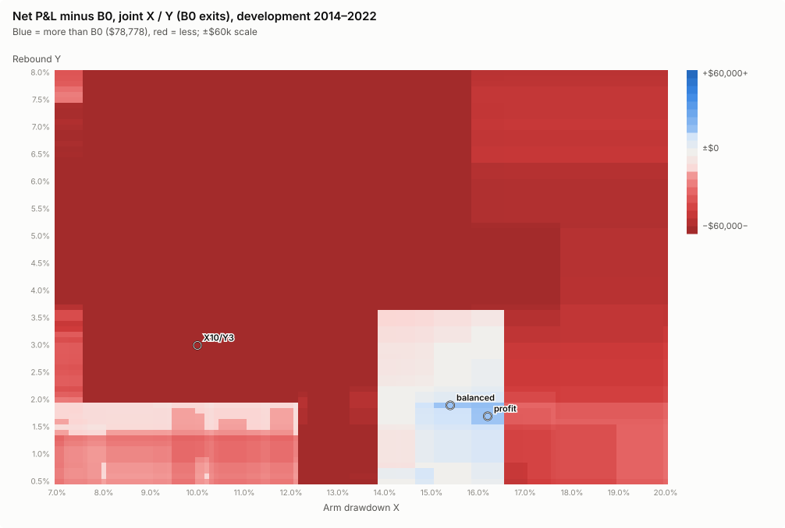
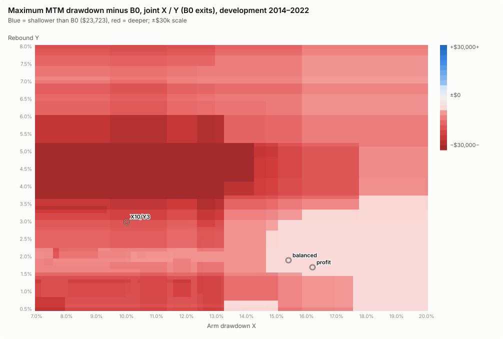
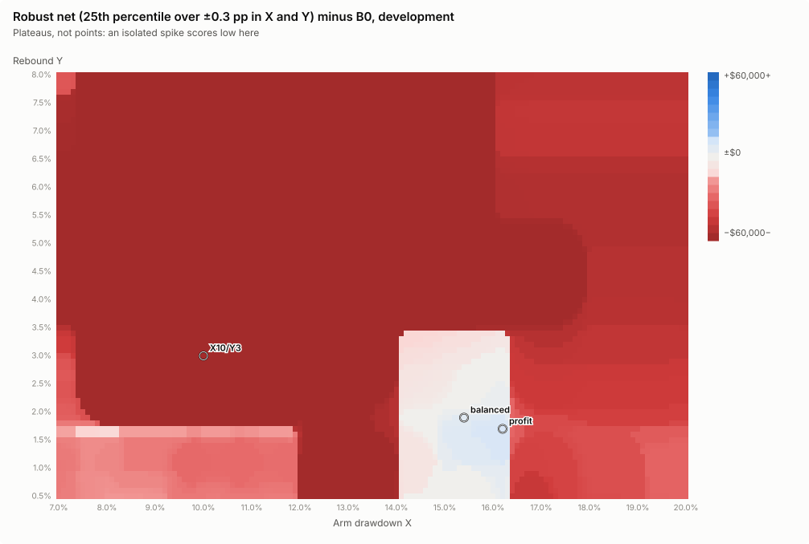

# Phase 2: joint arm level X and rebound Y

**Result: a deeper arm level helps the trailing entry, but never to the point of beating B0 on both objectives, and the same deeper level helps an *immediate* entry more.** Of the 9,956 X × Y points (exits at B0), 446 earn more than B0 on development, **none** has a drawdown at or below B0's $23,723, and none has a robust (neighbourhood) result that beats B0 on both. Every walk-forward pick fails (Σ −$8k … $13k against B0's $84k). The immediate-entry X-only grid, the fair comparator, keeps more of B0's profit out of sample ($50–54k) but also fails.

Setup (PROTOCOL.md §6): X = 7.0% … 20.0% × Y = 0.5% … 8.0%, both in 0.1-pp steps (9,956 points; X = 10% / Y = 3% and every other anchor are on the grid), plus the legacy X grid 7.0% … 20.0% (131 points). All other settings at B0. Robust statistics over the 7 × 7 box (±0.3 pp in X and Y). Results: `results/phase2/`.

## The development map

| Grid | Points | Own net ≥ B0 | Own DD ≤ B0 | Own beats B0 on both | Robust beats B0 on both | Robust risk trade-off (P25 net ≥ 90% B0, P75 DD ≤ 85% B0) |
| --- | ---: | ---: | ---: | ---: | ---: | ---: |
| Trailing X / Y | 9,956 | 446 | **0** | **0** | **0** | **0** |
| Immediate X (legacy) | 131 | 42 | 27 | 2 | 0 | 0 |

The map has two regions:

- **X below about 12% (the original's territory).** Almost everything is red. Only Y ≤ 1.9% comes near B0's net, and it carries $33–44k drawdowns.
- **X ≈ 14–16.5% with Y ≤ 2%** is the only blue island. It is a block, not a single point (the robust-net map keeps it). But every point in it has a $29,728 drawdown, the March 2020 crash marked against a single trade, and it trades only 12–14 times in nine years. It is mostly the immediate-entry result at a deeper X: the legacy X grid peaks in the same place (X = 14.4%: $113,165 / $28,564), higher than any trailing point.

## Activation depth (10%, 15%, 20%) by episode speed and depth

The 11 development episodes (PROTOCOL.md §10, price-only):

| Episode start | Trough | End | Depth | Descent (sessions) | Speed | Shape | Failed rallies |
| --- | ---: | ---: | ---: | ---: | ---: | ---: | ---: |
| 2015-08-21 | 2015-08-25 | 2015-10-09 | 14.3% | 26 | gradual | V | 0 |
| 2016-01-07 | 2016-02-09 | 2016-03-17 | 16.6% | 46 | gradual | V | 1 |
| 2018-02-08 | 2018-02-08 | 2018-02-14 | 10.3% | 9 | fast | V | 0 |
| 2018-04-02 | 2018-04-02 | 2018-04-17 | 10.3% | 13 | fast | V | 0 |
| 2018-10-11 | 2018-12-24 | 2019-02-25 | 24.0% | 56 | gradual | slow | 4 |
| 2019-06-03 | 2019-06-03 | 2019-06-07 | 11.5% | 22 | fast | V | 0 |
| 2020-02-25 | 2020-03-23 | 2020-05-29 | 32.0% | 23 | fast | slow | 4 |
| 2020-09-08 | 2020-09-23 | 2020-10-09 | 12.9% | 14 | fast | V | 1 |
| 2020-10-28 | 2020-10-30 | 2020-11-05 | 12.3% | 41 | gradual | V | 0 |
| 2021-03-04 | 2021-03-08 | 2021-04-01 | 11.3% | 14 | fast | V | 0 |
| 2022-01-19 | 2022-10-14 | not recovered by 2022-12-30 | 35.2% | 201 | gradual | slow | 9 |

Σ block P&L difference against B0 by episode class (development; number of episodes in brackets; `results/phase2/depth_episode_attribution.csv`):

| Run | Net | Max DD | fast 10–15% | fast ≥ 25% | gradual 10–15% | gradual 15–20% | gradual 20–25% | gradual ≥ 25% |
| --- | ---: | ---: | ---: | ---: | ---: | ---: | ---: | ---: |
| X = 10% Y = 1% | $49,708 | $43,238 | −$20,367 (5) | −$17,494 (1) | −$3,129 (2) | +$55,857 (1) | −$18,764 (1) | −$25,173 (1) |
| X = 10% Y = 3% | $3,743 | $41,866 | −$24,014 (5) | −$17,494 (1) | −$8,589 (2) | +$43 (1) | −$948 (1) | −$24,032 (1) |
| X = 10% Y = 5% | −$29,194 | $78,315 | −$24,214 (5) | −$17,494 (1) | −$11,730 (2) | +$8,509 (1) | −$1,983 (1) | −$61,059 (1) |
| legacy X = 15% | $95,880 | $28,884 | −$18,480 (5) | −$20,965 (1) | −$17,167 (2) | +$63,216 (1) | +$4,847 (1) | +$5,652 (1) |
| X = 15% Y = 2% | $82,049 | $29,728 | −$18,480 (5) | −$16,419 (1) | −$17,167 (2) | +$57,983 (1) | +$3,818 (1) | −$6,465 (1) |
| X = 15% Y = 3% | $73,505 | $31,346 | −$18,480 (5) | −$16,419 (1) | −$17,167 (2) | +$57,983 (1) | +$2,171 (1) | −$13,361 (1) |
| legacy X = 20% | $14,256 | $24,974 | −$18,480 (5) | −$53,647 (1) | −$17,167 (2) | +$8,761 (1) | +$8,502 (1) | +$7,508 (1) |
| X = 20% Y = 2% | $38,054 | $29,728 | −$18,480 (5) | −$16,419 (1) | −$17,167 (2) | +$8,761 (1) | +$4,632 (1) | −$2,052 (1) |

(No development episode was both fast and 15–25% deep.) What deeper activation does:

- **It skips the five shallow fast dips** (−$18.5k at X = 15% or 20%, trailing or not): B0 makes money buying them.
- **The gradual 2016 correction dominates every deeper-X result** (+$58k to +$63k at X = 15%). That is the single long 2016–2018 trade, a knife-edge path that a few sessions' difference creates or destroys.
- **In the deep, gradual 2018 Q4 and 2022 declines** a deeper *immediate* entry is better than B0 (+$4.8k, +$5.7k at X = 15%). Adding a trailing rebound on top makes 2022 worse again (−$6.5k at Y = 2%, −$13.4k at Y = 3%): it buys the bear-market rallies.
- **In the fast 2020 crash** every deeper or delayed entry loses to B0 (−$16k to −$54k). B0 took two small losses (bought 2020-02-25 at $29.35, 15-day exit −$8.8k; bought 2020-03-12, gap-stop −$2.4k), then bought again within days of the low (2020-03-20 at $22.43, +$7.4k; 2020-04-02 at $24.67, held to 2020-09-04 for +$48.0k). Its fast re-entries are what captured the V.

So the brief's question "do activations near 10%, 15% and 20% behave differently in fast drops and gradual bear markets?" has a clear answer: yes. But on development the difference is carried by individual paths (one 2016 trade, one 2020 sequence), not by a rule that separates fast from gradual declines in advance. No speed filter was added (the protocol forbids it without separate proof, and the prior study `research/vgt-drawdown-entry-risk` found speed does not discriminate).

## Walk-forward

Picks per fold (joint X / Y; full table with robust statistics in `results/phase2/tables.md`):

| Fold | profit | balanced | lowDD |
|---|---|---|---|
| WF1 (2014–2017) | X 11.4% Y 0.5% | same | X 7.2% Y 7.5% |
| WF2 (2014–2019) | X 10.9% Y 1.7% | X 11.5% Y 4.9% | X 7.1% Y 2.6% |
| WF3 (2014–2021) | X 7.7% Y 0.5% | X 12.3% Y 7.2% (fallback) | X 7.3% Y 8.0% |
| FINAL (2014–2022) | X 16.2% Y 1.7% ($94,121 / $29,728) | X 15.4% Y 1.9% (fallback; $94,681 / $29,728) | same as balanced |

The picks wander across the whole map from fold to fold, a sign that there is no stable optimum to find.

| Family | Pick | WF1 2018–19 | WF2 2020–21 | WF3 2022 | Σ net | Worst DD | Class vs B0 |
| --- | --- | ---: | ---: | ---: | ---: | ---: | ---: |
| **B0** | – | $31,701 / $23,723 | $57,240 / $15,660 | −$4,758 / $21,887 | **$84,183** | **$23,723** | – |
| Trailing X / Y | profit | −$4,231 / $32,308 | $32,024 / $23,751 | −$36,203 / $42,375 | −$8,411 | $42,375 | Fails |
| Trailing X / Y | balanced | −$4,231 / $32,308 | $34,732 / $23,751 | −$22,059 / $29,493 | $8,442 | $32,308 | Fails |
| Trailing X / Y | lowDD | $9,796 / $31,319 | $29,337 / $23,751 | −$25,670 / $32,167 | $13,463 | $32,167 | Fails |
| Immediate X | profit | $1,018 / $30,188 | $56,092 / $21,695 | −$3,193 / $19,729 | $53,917 | $30,188 | Fails |
| Immediate X | balanced | $1,018 / $30,188 | $57,240 / $15,660 | −$8,415 / $21,887 | $49,843 | $30,188 | Fails |
| Immediate X | lowDD | $1,018 / $30,188 | $57,240 / $15,660 | −$8,415 / $21,887 | $49,843 | $30,188 | Fails |

Flat-start validation gives the same classes (`results/phase2/xy/validation.csv`).

## Conclusion

Joint X / Y tuning finds a profitable island at X ≈ 15%, Y ≤ 2% on development. It is an immediate-entry effect of the deeper arm level plus one 2016 trade, it never lowers the drawdown below B0's, and it does not survive walk-forward. Phase 3 tests whether scaling the rebound by volatility does better.
