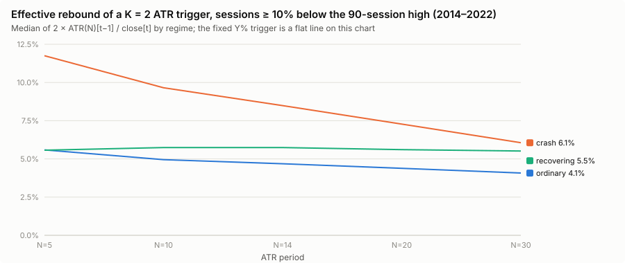

# Phase 3: ATR-scaled rebound

**Result: ATR scaling does not rescue the trailing entry.** Making the rebound `K × ATR(N)` instead of a fixed `Y%` opens a region of lower development drawdown (5,286 of 23,580 snapshot points have a drawdown at or below B0's, against none in the fixed grid). But almost all of that region earns little, and every ATR walk-forward pick fails against B0 (Σ −$15k … $19k vs $84k). By the pre-registered rule (PROTOCOL.md §8), the ATR family beat the fixed-percent family on 2 of 3 picks and therefore went on to Phase 4. That says more about how weak fixed-percent was than about ATR being good.

Setup: trigger = trough + K × ATR(N), exits at B0. **Snapshot** (primary): the ATR of the session before the trough, held until a lower trough. **Rolling** (robustness): the ATR of the session before each test. N ∈ {5, 10, 14, 20, 30}, K = 0.5 … 4.0 (0.1), X = 7.0% … 20.0% (0.1 pp): 23,580 points per variant. Neighbourhood ±0.3 pp in X, ±0.3 in K, adjacent listed N. Definitions in STATE_MACHINE.md; results in `results/phase3/`.

## What the ATR trigger means in percent

Effective rebound per unit of K, `ATR(N)[t−1] / close[t]`, over sessions at least 10% below the 90-session high (development; regimes from the price-only episodes of PROTOCOL.md §10):

| Period | ordinary correction (< 20% deep), before the trough | crash (fast ≥ 20%), before the trough | bear (gradual ≥ 20%), before the trough | recovering (after any trough) |
| --- | ---: | ---: | ---: | ---: |
| N=5 | 2.79% (p10–p90 2.00–3.86%), 41 sessions | 5.88% (3.59–9.49%), 17 | 2.84% (2.36–3.65%), 198 | 2.79% (1.87–4.53%), 134 |
| N=10 | 2.48% (1.83–3.00%) | 4.83% (2.81–7.95%) | 2.82% (2.39–3.49%) | 2.87% (2.10–4.84%) |
| N=14 | 2.34% (1.73–2.79%) | 4.24% (2.49–6.98%) | 2.81% (2.42–3.49%) | 2.87% (2.20–4.96%) |
| N=20 | 2.19% (1.65–2.61%) | 3.64% (2.19–5.94%) | 2.76% (2.42–3.45%) | 2.80% (2.26–4.81%) |
| N=30 | 2.04% (1.61–2.44%) | 3.03% (1.91–4.84%) | 2.75% (2.32–3.38%) | 2.76% (2.22–4.36%) |

So K = 1 is roughly a 2–3% fixed rebound in ordinary corrections and bear markets, and 3–6% in a fast crash. The ATR trigger does what it is meant to do: it demands more of a bounce when volatility is extreme (March 2020), and is nearly a fixed percentage otherwise. The gradual 2018 Q4 and 2022 declines (198 of the 256 pre-trough sessions here) sit at a steady ~2.8% per unit K.

## Development results

| Grid | Points | Own net ≥ B0 | Own DD ≤ B0 | Own beats B0 on both | Robust beats B0 on both |
| --- | ---: | ---: | ---: | ---: | ---: |
| ATR snapshot | 23,580 | 404 | 5,286 | 6 | 0 |
| ATR rolling | 23,580 | 413 | 5,449 | 12 | 0 |
| Fixed X / Y (Phase 2) | 9,956 | 446 | 0 | 0 | 0 |

B0 = $78,778 / $23,723. The handful of points that beat B0 on both are isolated: none survives the neighbourhood test.

Best feasible snapshot point per period (development):

| Period | Highest robust net at | Net / DD | Lowest robust DD at | Net / DD |
| --- | ---: | ---: | ---: | ---: |
| N=5 | X 16.2% K 0.5 | $81,772 / $29,728 | X 9.1% K 3.1 | $3,491 / $22,011 |
| N=10 | X 16.2% K 0.5 | $81,063 / $30,347 | X 7.0% K 3.3 | $77,286 / $25,758 |
| N=14 | X 15.8% K 0.5 | $78,522 / $32,074 | X 9.1% K 3.4 | $1,026 / $26,926 |
| N=20 | X 16.0% K 0.5 | $81,063 / $30,347 | X 7.4% K 3.9 | $38,190 / $28,028 |
| N=30 | X 16.2% K 0.5 | $81,063 / $30,347 | X 7.6% K 3.9 | $24,369 / $26,597 |

Two regimes again. **Small K (0.5) at deep X** reproduces Phase 2's X ≈ 15–16% island: K × ATR ≈ 1–1.5%, i.e. a small fixed rebound. **Large K (3–4) at shallow X (7–9%)** gives low drawdowns, because the rule then trades rarely and only after strong bounces. It also gives up most of the profit. No period stands out.

## Walk-forward

Picks per fold (full tables in `results/phase3/tables.md`):

| Fold | Snapshot profit | Snapshot balanced | Snapshot lowDD |
|---|---|---|---|
| WF1 | X 11.3% K 0.5 N 14 | same | X 7.0% K 3.6 N 10 |
| WF2 | X 11.4% K 0.9 N 30 | X 7.0% K 3.3 N 10 | X 7.3% K 3.4 N 10 |
| WF3 | X 8.0% K 0.8 N 30 | X 7.2% K 3.2 N 10 | X 11.2% K 0.6 N 5 |
| FINAL | X 16.2% K 0.5 N 5 ($81,772 / $29,728) | X 9.1% K 3.1 N 5 ($3,491 / $22,011) | X 15.4% K 0.6 N 30 ($85,451 / $29,728) |

| Family | Pick | WF1 2018–19 | WF2 2020–21 | WF3 2022 | Σ net | Worst DD | Class vs B0 |
| --- | --- | ---: | ---: | ---: | ---: | ---: | ---: |
| **B0** | – | $31,701 / $23,723 | $57,240 / $15,660 | −$4,758 / $21,887 | **$84,183** | **$23,723** | – |
| ATR snapshot | profit | −$4,231 / $32,308 | $29,428 / $23,751 | −$26,572 / $34,907 | −$1,374 | $34,907 | Fails |
| ATR snapshot | balanced | −$4,231 / $32,308 | $25,417 / $17,456 | −$2,612 / $18,435 | $18,574 | $32,308 | Fails |
| ATR snapshot | lowDD | $12,237 / $19,182 | −$4,944 / $17,962 | −$22,198 / $32,456 | −$14,905 | $32,456 | Fails |
| ATR rolling | profit | −$4,233 / $32,310 | $36,595 / $23,751 | −$26,205 / $36,463 | $6,157 | $36,463 | Fails |
| ATR rolling | balanced | −$4,233 / $32,310 | $10,431 / $16,266 | −$6,997 / $12,508 | −$800 | $32,310 | Fails |
| ATR rolling | lowDD | $16,757 / $17,427 | $10,431 / $16,266 | −$19,986 / $30,244 | $7,202 | $30,244 | Fails |
| Fixed X / Y | profit | −$4,231 / $32,308 | $32,024 / $23,751 | −$36,203 / $42,375 | −$8,411 | $42,375 | Fails |
| Fixed X / Y | balanced | −$4,231 / $32,308 | $34,732 / $23,751 | −$22,059 / $29,493 | $8,442 | $32,308 | Fails |
| Fixed X / Y | lowDD | $9,796 / $31,319 | $29,337 / $23,751 | −$25,670 / $32,167 | $13,463 | $32,167 | Fails |

## Continuation test (PROTOCOL.md §8)

| Pick | ATR snapshot Σ net / worst DD | Fixed X / Y Σ net / worst DD | ATR vs fixed |
| --- | ---: | ---: | ---: |
| profit | −$1,374 / $34,907 | −$8,411 / $42,375 | Dominant |
| balanced | $18,574 / $32,308 | $8,442 / $32,308 | Dominant |
| lowDD | −$14,905 / $32,456 | $13,463 / $32,167 | Fails |

ATR snapshot beat fixed-percent on 2 of 3 picks, so by the pre-registered rule it entered Phase 4. Both families lose to B0 by a wide margin. "Better than fixed-percent" here means "less bad", and it holds for two of three picks only. Rolling vs fixed: profit Dominant, balanced and lowDD Fail.

**Snapshot vs rolling ATR.** On development the two are almost indistinguishable (identical best points per period, near-identical plateau counts). In walk-forward neither is consistently ahead (snapshot ahead on balanced, rolling on profit and lowDD). The extra choice adds nothing.

## Conclusion

ATR normalization makes the trigger adapt to crash volatility as intended, but it does not change the economics found in Phases 1–2: a delayed entry pays more than it saves. The low-drawdown ATR region is low-drawdown because it barely trades. ATR does not earn its extra complexity against B0. It continued to Phase 4 only because the protocol compares it with the (worse) fixed-percent family.
