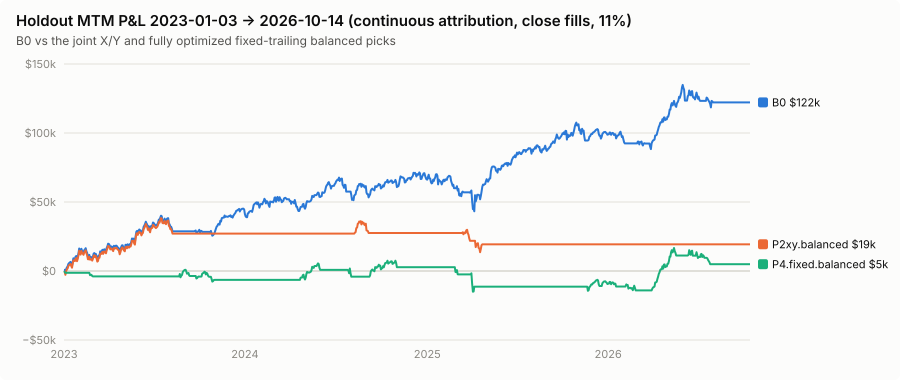
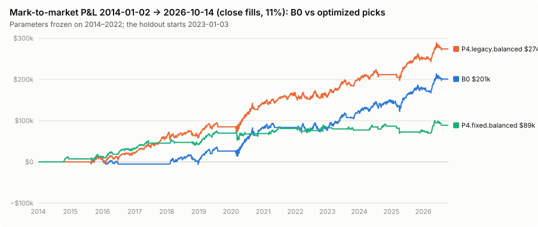
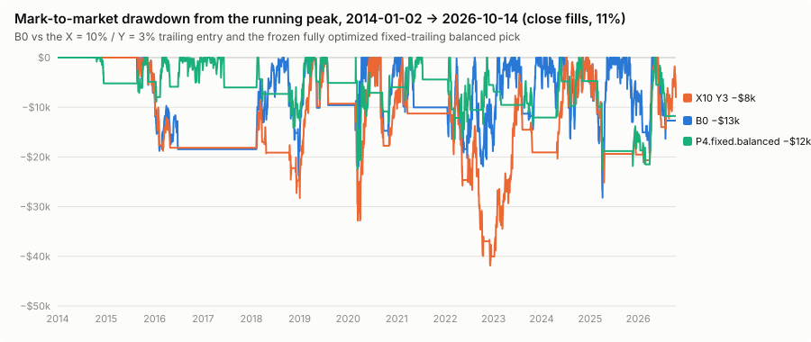

# Validation and robustness (Phase 6)

**Result: no candidate meets the acceptance standard. 24 candidate types were tested against nine criteria; the best pass one.** The walk-forward (criterion 1) and the holdout (criterion 2) both fail for every trailing-entry candidate and for every re-optimized immediate-entry candidate. The event-level bootstrap puts the probability that the trailing picks beat B0 on the holdout's episode blocks between 0.0% and 4.8%. Where a candidate looks better than B0 (a much shallower holdout drawdown, a better parameter neighbourhood, a better start-date ensemble), the improvement comes with a large loss of profit or is confined to one window, execution model or rate.

Windows, folds and rules: PROTOCOL.md (hash-registered before any trailing result; Amendments 1–2 before the holdout). The holdout ran once (`results/holdout/attempts.json`: attempt 1, 2026-10-16T22:37:45Z, after the freeze at 22:37:39Z). Every number below is from `results/validation/development/` (pre-freeze) or `results/holdout/` (post-freeze).

## 1. Acceptance (PROTOCOL.md §9)

Each criterion: Dominant (net ≥ B0 + $5k with DD ≤ B0's, or DD ≤ 90% of B0's with net ≥ B0's) or Risk trade-off (DD ≤ 85% of B0's with net ≥ 90% of B0's), else Fails. WF = each fold's own pick on its validation window (Σ net, worst DD); holdout = the FINAL pick on 2023-01-03 → 2026-10-14; C5 = median of the one-at-a-time development perturbations against B0.

| Candidate | C1 WF | C2 holdout | C3 WF next open | C3 holdout next open | C4 WF 8% | C4 WF 14% | C4 holdout 8% | C4 holdout 14% | C5 perturbations | Passed | vs optimized legacy (WF / holdout) |
| --- | --- | --- | --- | --- | --- | --- | --- | --- | --- | ---: | --- |
| P1.profit | Fails | Fails | Fails | Fails | Fails | Fails | Fails | Fails | Fails | 0 / 9 | Fails / Fails |
| P1.balanced | Fails | Fails | Fails | Risk trade-off | Fails | Fails | Fails | Fails | Fails | 1 / 9 | Fails / Fails |
| P1.lowDD | Fails | Fails | Fails | Fails | Fails | Fails | Fails | Fails | Fails | 0 / 9 | Fails / Fails |
| P2xy.profit | Fails | Fails | Fails | Fails | Fails | Fails | Fails | Fails | Fails | 0 / 9 | Fails / Fails |
| P2xy.balanced | Fails | Fails | Fails | Fails | Fails | Fails | Fails | Fails | Fails | 0 / 9 | Fails / Fails |
| P2xy.lowDD | Fails | Fails | Fails | Fails | Fails | Fails | Fails | Fails | Fails | 0 / 9 | Fails / Fails |
| P2legacy (all three) | Fails | Fails | Fails | Fails | Fails | Fails | Fails | Fails | Fails | 0 / 9 | Fails / Fails |
| P3snap (all three) | Fails | Fails | Fails | Fails | Fails | Fails | Fails | Fails | Fails | 0 / 9 | Fails / Fails |
| P3roll (all three) | Fails | Fails | Fails | Fails | Fails | Fails | Fails | Fails | Fails | 0 / 9 | Fails / Fails |
| P4.legacy.profit | Fails | Fails | Fails | Fails | Fails | Fails | Fails | Fails | Fails | 0 / 9 | – |
| P4.legacy.balanced | Fails | Fails | Fails | Fails | Fails | Fails | Fails | Fails | Dominant | 1 / 9 | – |
| P4.legacy.lowDD | Fails | Fails | Fails | Fails | Fails | Fails | Fails | Fails | Dominant | 1 / 9 | – |
| P4.fixed (all three) | Fails | Fails | Fails | Fails | Fails | Fails | Fails | Fails | Fails | 0 / 9 | Fails / Fails |
| P4.atr.profit | Fails | Fails | Fails | Fails | Fails | Fails | Fails | Fails | Fails | 0 / 9 | Fails / Fails |
| P4.atr.balanced | Fails | Fails | Fails | Fails | Fails | Fails | Fails | Fails | Dominant | 1 / 9 | Fails / Fails |
| P4.atr.lowDD | Fails | Fails | Fails | Fails | Fails | Fails | Fails | Fails | Fails | 0 / 9 | Fails / Fails |

P1 = Phase 1 (X 10%, Y tuned), P2xy = Phase 2 joint X/Y, P2legacy = Phase 2 immediate X only, P3snap/P3roll = Phase 3 ATR, P4 = Phase 4 full optimization; all exits at B0 except P4. Per-candidate rows: `results/holdout/acceptance.json`. The three C5 passes are for candidates whose own development result is far above B0's because they were optimized on that window; C5 is an in-sample neighbourhood check and cannot rescue a C1/C2 failure.

## 2. Walk-forward consistency

All picks, all three folds (close @ 11%; next-open and rate variants in `results/validation/development/tables.md`):

| Candidate | WF1 2018–19 | WF2 2020–21 | WF3 2022 | Σ net / worst DD |
| --- | ---: | ---: | ---: | ---: |
| **B0** | $31,701 / $23,723 | $57,240 / $15,660 | −$4,758 / $21,887 | **$84,183 / $23,723** |
| P1.balanced | $2,804 / $26,623 | $29,529 / $15,853 | −$22,059 / $29,493 | $10,274 / $29,493 |
| P2xy.balanced | −$4,231 / $32,308 | $34,732 / $23,751 | −$22,059 / $29,493 | $8,442 / $32,308 |
| P2legacy.profit | $1,018 / $30,188 | $56,092 / $21,695 | −$3,193 / $19,729 | $53,917 / $30,188 |
| P3snap.balanced | −$4,231 / $32,308 | $25,417 / $17,456 | −$2,612 / $18,435 | $18,574 / $32,308 |
| P4.legacy.balanced | $41,930 / $16,477 | $13,360 / $28,084 | −$16,338 / $21,882 | $38,953 / $28,084 |
| P4.fixed.balanced | $9,393 / $28,278 | −$11,703 / $30,998 | −$22,873 / $28,477 | −$25,184 / $30,998 |
| P4.atr.balanced | $17,901 / $28,278 | −$8,300 / $25,176 | −$25,688 / $28,088 | −$16,086 / $28,278 |

No candidate beats B0 on net in more than one of the three folds, and none does in 2020–2021. Five beat it in a single fold: the optimized legacy profit and balanced picks in 2018–2019 ($41.9k vs $31.7k), and P2legacy.profit, P3snap.balanced and P4.atr.lowDD in 2022, by losing less (−$3.2k, −$2.6k, −$3.3k vs −$4.8k). None of these carries over to another fold.

## 3. Holdout 2023-01-03 → 2026-10-14

FINAL picks (frozen on 2014–2022), continuous attribution (flat start in the last column):

| Candidate | close @ 11% | next open @ 11% | close @ 8% | close @ 14% | flat start, close |
| --- | ---: | ---: | ---: | ---: | ---: |
| **B0** | **$122,197 / $28,208** | $127,058 / $25,780 | $132,604 / $27,395 | $115,273 / $29,022 | $121,953 / $28,208 |
| B0c (0.5% / 3% control) | $117,912 / $28,687 | $127,058 / $25,780 | $126,881 / $28,079 | $112,427 / $29,295 | $117,668 / $28,687 |
| P1.profit | $83,710 / $30,619 | $64,518 / $28,057 | $91,469 / $29,838 | $76,890 / $31,400 | $112,046 / $30,619 |
| P1.balanced | $69,054 / $25,365 | $117,568 / $20,408 | $76,763 / $24,305 | $62,283 / $25,982 | $69,020 / $25,365 |
| P1.lowDD | $41,375 / $25,143 | $53,337 / $28,203 | $47,309 / $24,305 | $36,379 / $25,982 | $69,711 / $25,143 |
| P2xy.profit | −$3,713 / $9,480 | $34,990 / $12,777 | −$3,540 / $9,332 | −$3,886 / $9,628 | $24,623 / $19,451 |
| P2xy.balanced = lowDD | $19,383 / $24,740 | $60,835 / $19,880 | $21,709 / $24,083 | $17,056 / $25,398 | $19,349 / $24,725 |
| P2legacy.profit | $25,527 / $20,583 | $71,558 / $17,019 | $27,927 / $20,238 | $23,127 / $20,928 | $25,283 / $20,583 |
| P2legacy.balanced = lowDD | $116,893 / $28,988 | $110,840 / $25,856 | $126,248 / $28,363 | $111,021 / $29,612 | $116,649 / $28,988 |
| P3snap.profit | $31,621 / $16,127 | −$7,491 / $12,221 | $33,487 / $16,028 | $29,755 / $16,225 | $59,957 / $26,097 |
| P3snap.balanced | $69,182 / $17,709 | $66,394 / $18,097 | $74,467 / $17,504 | $63,897 / $18,084 | $69,182 / $17,709 |
| P3snap.lowDD | −$8,988 / $22,473 | $31,412 / $17,754 | −$8,437 / $22,103 | −$9,538 / $22,843 | $19,349 / $24,725 |
| P3roll.balanced | $57,013 / $18,083 | $54,892 / $17,493 | $61,920 / $17,886 | $52,107 / $18,281 | $56,475 / $18,083 |
| P4.legacy.profit | $88,714 / $27,755 | $107,759 / $28,836 | $95,815 / $27,360 | $85,416 / $28,149 | $88,462 / $27,755 |
| P4.legacy.balanced | $114,904 / $26,218 | $74,475 / $27,192 | $121,203 / $25,824 | $106,635 / $26,613 | $114,656 / $26,218 |
| P4.legacy.lowDD | −$3,342 / $8,192 | $31,476 / $8,644 | −$3,194 / $8,151 | −$3,490 / $8,233 | −$3,342 / $8,192 |
| P4.fixed.profit | −$9,486 / $15,003 | −$3,398 / $15,224 | −$9,313 / $14,954 | −$9,658 / $15,052 | −$9,486 / $15,003 |
| P4.fixed.balanced = lowDD | $4,935 / $22,485 | $37,800 / $19,190 | $7,697 / $22,386 | $6,225 / $22,706 | $15,939 / $22,485 |
| P4.atr.profit | $37,675 / $31,349 | $80,060 / $24,437 | $44,555 / $30,536 | $43,094 / $32,163 | $62,304 / $31,349 |
| P4.atr.balanced | $31,220 / $18,779 | $66,794 / $18,358 | $34,976 / $18,081 | $28,229 / $18,712 | $31,220 / $18,779 |
| P4.atr.lowDD | $74,432 / $10,584 | $66,571 / $11,974 | $78,451 / $10,486 | $70,413 / $10,683 | $74,432 / $10,584 |

(P3roll.profit and lowDD equal P3snap's.) Holdout detail (interest, entries, win rate, time in market, worst open-trade mark, worst low below entry, setups) is in `results/holdout/tables.md`.

- **Lower drawdown always costs a lot of profit.** P4.atr.lowDD has the shallowest drawdown among active candidates ($10,584, 62% below B0's), but earns 61% of B0's net ($74,432) and is in the market 36% of the time vs B0's 84%. P3snap.balanced: −37% drawdown, −43% net. No candidate reaches the risk-trade-off line (≥ 90% of the net with ≤ 85% of the drawdown).
- **Sparse candidates.** The deep-X picks (P2xy.profit, P4.legacy.lowDD, P4.fixed.profit; X 15.8–20%) traded **once** in the holdout. Their small drawdowns reflect that inactivity, not a protective rule.
- **Flat start** (adopting the strategy fresh on 2023-01-03) changes no class: B0 is $121,953 / $28,208, and every candidate keeps its verdict (`results/holdout/acceptance.json`: "same class" for all).

**Extended shortlists on the holdout** (Amendment 1; 10 per family, close @ 11%; B0 $122,197 / $28,208). Every one of the 30 fails against B0. Best by net in each family: legacy #3 $114,904 / $26,218 (the balanced pick); fixed #6 $17,015 / $14,073; ATR #2 $82,311 / $28,517 and #9–#10 $77,431 / $13,824. Full table: `results/holdout/tables.md` and `shortlists_holdout.csv`.

## 4. Event-level uncertainty

Block bootstrap over correction episodes (candidate − B0 per attribution block; blocks = episode start to next episode start; 10,000 resamples; never daily returns):

| Candidate | WF validation blocks: Σ difference (90% interval), P(Σ > 0) | Holdout blocks: Σ difference (90% interval), P(Σ > 0) |
| --- | --- | --- |
| P1.balanced | −$73,909 (−$113,257 … −$38,552), 0.000 | −$53,143 (−$134,303 … −$4,651), 0.015 |
| P2xy.balanced | −$75,741 (−$115,037 … −$38,900), 0.000 | −$102,815 (−$181,051 … −$32,422), 0.002 |
| P2legacy.balanced | −$34,339 (−$60,702 … −$12,174), 0.001 | −$5,304 (−$16,474 … +$5,822), 0.185 |
| P3snap.balanced | −$65,608 (−$101,902 … −$32,069), 0.001 | −$53,015 (−$83,366 … −$25,603), 0.000 |
| P4.legacy.balanced | −$45,230 (−$152,525 … +$38,431), 0.241 | −$7,293 (−$15,557 … +$932), 0.074 |
| P4.fixed.balanced | −$109,366 (−$226,539 … −$23,090), 0.004 | −$117,262 (−$203,714 … −$41,983), 0.000 |
| P4.atr.balanced | −$100,269 (−$209,949 … −$21,437), 0.004 | −$90,977 (−$163,663 … −$26,597), 0.000 |
| P4.atr.lowDD | −$93,370 (−$176,707 … −$29,243), 0.000 | −$47,765 (−$105,985 … −$9,212), 0.003 |

There are 12 walk-forward blocks and 10 holdout blocks. The intervals are wide, but for every trailing-entry candidate they exclude zero in both samples. Only the re-optimized *immediate* entries (P2legacy, P4.legacy) have intervals that include zero. All rows: `bootstrap_wf.json`, `results/holdout/bootstrap.json`.

## 5. Parameter perturbations

One parameter at a time: percentages and K ±0.1/±0.3/±0.5 pp, L ±2/5/10, loss-exit age ±1/2/3 days, N ±1/2/4 (39–51 perturbations per candidate).

| Candidate | Development: own / median of perturbations / worst | Holdout: median / worst |
| --- | --- | --- |
| B0 | $78,778 / $23,723 · median the same · worst — | $120,435 / $28,208 · $78,232 / $29,783 |
| P1.balanced | $66,344 / $33,733 · $66,144 / $33,733 · $3,054 / $55,846 | $69,054 / $25,365 · $41,375 / $31,032 |
| P2xy.balanced | $94,681 / $29,728 · $94,681 / $29,728 · $38,576 / $41,469 | $19,383 / $24,740 · −$8,988 / $26,250 |
| P4.legacy.balanced | $159,071 / $21,714 · $156,458 / $21,714 · $58,551 / $36,976 | $114,904 / $26,218 · $730 / $32,261 |
| P4.fixed.balanced | $83,892 / $22,412 · $82,128 / $22,412 · $18,217 / $44,371 | $4,935 / $22,485 · $1,059 / $32,417 |
| P4.atr.balanced | $94,268 / $22,229 · $94,268 / $22,229 · −$760 / $36,627 | $31,220 / $18,779 · $27,393 / $24,751 |
| P4.atr.lowDD | $65,531 / $9,828 · $65,531 / $9,828 · −$8,504 / $26,541 | $74,432 / $10,584 · $36,950 / $14,714 |

Medians sit on the candidates' own results because most single-parameter nudges leave the trade list unchanged. The worst cases show cliffs: one 0.1–0.5 pp change can take a candidate from ~$90k to ~$0 (P4.atr.balanced) or from $159k to $59k (P4.legacy.balanced). The robust picks sit on ridges, not plateaus.

## 6. Start dates

| Candidate | Development (24 starts, first session of each month 2014-01 … 2015-12, to 2022-12-30): range / starts passing vs B0 | Holdout (12 flat starts, each month of 2023, to 2026-10-14): range / passing |
| --- | --- | --- |
| B0 | $76,507 … $78,778 | $78,704 … $121,953 |
| P1.balanced | $65,705 … $66,699 / 0 of 24 | $22,239 … $69,020 / 0 of 12 |
| P2xy.balanced | $94,681 / 0 of 24 | −$7,743 … $19,349 / 0 of 12 |
| P4.legacy.balanced | $156,211 … $159,071 / 24 of 24 | $73,069 … $114,656 / 0 of 12 |
| P4.fixed.balanced | $70,707 … $83,892 / 10 of 24 | $6,205 … $20,280 / 0 of 12 |
| P4.atr.balanced | $94,268 … $99,602 / 24 of 24 | $25,988 … $34,326 / 0 of 12 |
| P4.atr.lowDD | $64,048 … $65,531 / 0 of 24 | $65,709 … $77,555 / 0 of 12 |

Development start dates are in sample for every optimized pick (their parameters were fitted on the 2014-01-02 start), so passing there means little. On the holdout no candidate passes against B0 for **any** of the 12 start months.

## 7. Data quality

Replacing 2015-08-24's dislocated low (−23% intraday, the ETF opening dislocation) by min(open, close) changes no trade for B0, the fixed-percent candidates or the optimized legacy ones. It changes the ATR candidates slightly, because the low enters the true range: P3snap.balanced $3,491 → −$768, P4.atr.balanced $94,268 → $94,601, P4.atr.lowDD $65,531 / $9,828 → $64,168 / $10,365. No conclusion depends on that bar. The input series were otherwise clean (BASELINE_AUDIT.md §3).

## 8. Cross-asset transfer (no re-optimization)

VGT-frozen FINAL picks on six other ETFs (Stooq, 2014-01-02 → 2026-09-04), net / DD, ✓ = Dominant or risk trade-off vs B0 on the same ETF:

| Run | QQQ | VOOG | SOXX | IGV | XLY | IWN |
| --- | ---: | ---: | ---: | ---: | ---: | ---: |
| **B0** | $111,472 / $35,220 | $89,111 / $31,317 | $103,064 / $59,812 | $104,034 / $39,231 | $63,833 / $29,188 | $2,412 / $46,270 |
| P1.balanced | $67,811 / $47,560 ✗ | $44,288 / $38,734 ✗ | $135,653 / $54,201 ✓ | $28,947 / $71,851 ✗ | −$1,502 / $60,940 ✗ | −$29,185 / $70,567 ✗ |
| P2xy.balanced | −$24,046 / $51,756 ✗ | $16,932 / $32,167 ✗ | $101,411 / $60,243 ✗ | $45,254 / $68,235 ✗ | $4,340 / $57,796 ✗ | $19,793 / $49,822 ✗ |
| P3snap.balanced | $23,899 / $19,500 ✗ | $38,808 / $18,044 ✗ | $73,819 / $37,762 ✗ | $23,195 / $29,217 ✗ | −$27,131 / $52,901 ✗ | −$57,060 / $77,494 ✗ |
| P4.legacy.balanced | $149,869 / $23,584 ✓ | $148,246 / $30,169 ✓ | $159,360 / $51,615 ✓ | $221,712 / $33,088 ✓ | $46,458 / $39,268 ✗ | −$12,329 / $60,460 ✗ |
| P4.fixed.balanced | $29,538 / $44,476 ✗ | −$1 / $37,553 ✗ | $17,918 / $63,008 ✗ | $32,650 / $52,506 ✗ | $13,554 / $37,908 ✗ | −$49,919 / $57,015 ✗ |
| P4.atr.balanced | $3,517 / $50,702 ✗ | −$4,056 / $43,998 ✗ | $17,370 / $41,010 ✗ | $94,934 / $36,911 ✗ | −$18,291 / $37,865 ✗ | −$20,475 / $55,610 ✗ |
| P4.atr.lowDD | $61,524 / $14,603 ✗ | $28,412 / $29,508 ✗ | $12,075 / $28,123 ✗ | −$890 / $26,382 ✗ | −$14,094 / $21,219 ✗ | −$25,691 / $47,140 ✗ |

All 24 candidates: `results/holdout/cross_asset.csv`. The trailing-entry picks transfer badly: each passes on at most two of the six ETFs, nearly always SOXX (strong 2023–2026 rally) or IWN (where B0 itself barely makes money, so it is easy to beat), and the balanced and lowDD Phase 4 trailing picks pass nowhere. The re-optimized legacy balanced pick transfers to four of six tech/growth ETFs. That is consistent with its parameters capturing something about the 2014–2022 tech cycle on the dip-and-stop side, but it failed on VGT's own walk-forward and holdout, so this is a hypothesis at most. Most of each ETF's 2014–2022 window is the period the VGT parameters were fitted on, and these funds are highly correlated with VGT.

## 9. Causality and implementation checks

- **Baseline parity:** the engine reproduces the immutable original byte for byte (11 cases, BASELINE_AUDIT.md), and four synthetic walks cover every exit and restriction path.
- **Independent replay:** a stdlib-Python implementation written only from STATE_MACHINE.md and the original matches the engine's trades, setups and totals **byte for byte on 25 of 25 configurations**: legacy / fixed / ATR snapshot / ATR rolling, close / next open, variants A / B, frozen activation / fill high, max-wait, margin 14%, custom exits, synthetic walks (`replay/REPLAY_REPORT.md`). Its noted ambiguities all match the engine's reading. One caveat: the frozen-high alternative changes no trade in development, so its agreement is untested in practice.
- **Lookahead review:** an independent code review (`LOOKAHEAD_REVIEW.md`) found no lookahead or leakage that could affect selection: 0 material issues; 3 minor disclosure points, recorded as PROTOCOL.md Amendment 4; and about 10,000 perturbation cases in which randomizing not-yet-known bars never changed an earlier decision or training metric. It also re-derived the frozen candidates from the result files with 0 differences.
- **Structural holdout isolation:** development commands load bars truncated at 2022-12-30 (a test checks it). The full series is opened only by the freeze-gated holdout command and the post-holdout reporting command. Training runs stop at the training end, and window metrics use only in-window marks.
- **Determinism:** the whole development pipeline reproduces byte-identically on 3 and 8 worker threads; tests compare in-process, 1-thread and 3-thread searches.
- **Tests:** 45 automated tests in `src/trailing-buy/tests/` cover the brief's 11 test areas (README.md lists them).

## 10. What limits these conclusions

- **Few independent events:** 11 development and 9 holdout correction episodes, and only 4 that reached −20% (one per regime: 2018 Q4, 2020, 2022, 2025). Each strategy is a single path whose total can swing tens of thousands of dollars on one fill (next-open vs close moves B0's walk-forward profit by $44k).
- **The holdout is not pristine** (PROTOCOL.md §3 and Amendment 4): a prior study evaluated entry-timing rules, including a rebound rule, on the same daily strategy over 2023–2026; 2025 and 2026 are publicized events known to the researcher; Phase 0's parity runs already contained B0's full-window totals; and the Phase 4 selection was corrected (Amendment 2) after its as-run results were seen but before any holdout result. The ATR family was admitted to Phase 4 on walk-forward validation results, so its C1 is mildly optimistic, which does not matter here since it fails anyway.
- **Idealized execution** (same-close fills) is used for all selection, and spreads and slippage are out of scope. Next-open and pre-close results are given separately (EXECUTION_SENSITIVITY.md).
- **Margin rates** are constant scenarios; actual historical broker rates could not be obtained.

Every one of these limits cuts against claiming an improvement. None of them could turn the observed results into evidence *for* the trailing entry.
