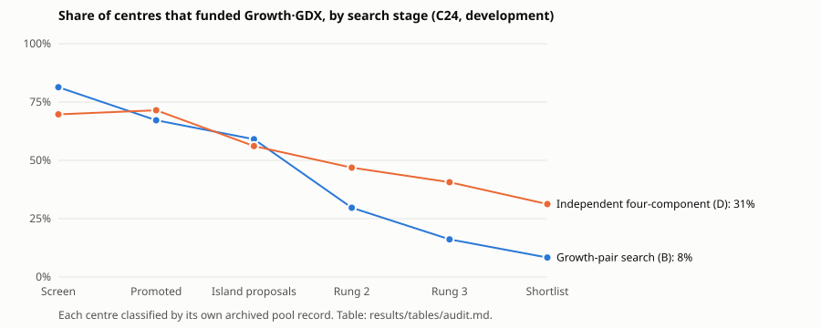
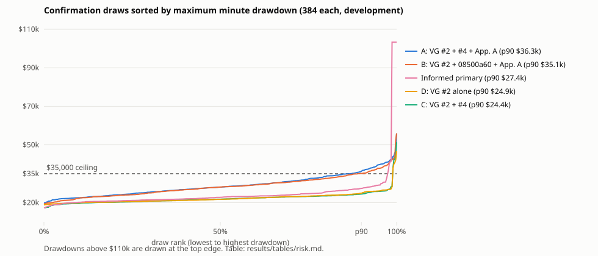

# REPORT — Priority 3A: why GDX Growth went unfunded, and what A's and B's neighbourhood failures mean

A bounded, read-only diagnostic of Priority 3 (`research/vg-d1-growth-joint/`). Research only, not deployed. Nothing
was searched, selected, retuned or relabelled. Priority 3's classification stands:

- the frozen primary failed validation;
- A and B fail Q3;
- C passed but is a three-component control.

Conventions are Priority 3's harmonized ones:

- one fixed $100,000 principal budget, no compounding, 5 bps per side, 11% simple interest;
- funding from 2016-01-04, D1 arming once its reference high exists;
- **DD** is the maximum minute drawdown of the marked net in dollars ($35,000 = 35% of the fixed budget, not of peak
  equity);
- development 2016-01-04 → 2024-12-31;
- 2025-01-02 → 2026-10-30 is **previously examined history**, replayed only to explain frozen subjects.

Historical compliance does not guarantee future drawdown.

Evidence: [participation](results/tables/participation.md) · [refusals](results/tables/refusals.md) ·
[search audit](results/tables/audit.md) · [risk](results/tables/risk.md) · [probes](results/tables/probes.md) ·
[2025–26 replay](results/tables/full.md), all generated from the sealed records in `results/`.

## 1. The answers

### Q1. Why did the newly optimized VGT + GDX Growth pools mostly fund only VGT?

Three things compound, in this order.

1. **The selected GDX Growth books hardly ever decided.** Over nine development years, the GDX books of the 12
   Growth-pair finalists and 16 independent finalists made:
   - **zero** decisions in 10 of the 28;
   - 1–4 decisions in 16;
   - 13–14 decisions in 2.

   Their crossings were vetoed or deferred by the trend filter or the Drawdown Recovery Gate. Where eligibility was on,
   its opportunities then expired or were invalidated.

   For example, G01 (the Growth-pair actual-profit role holder):
   - 30 GDX crossings from 2017-03-03, all deferred (18 trend filter, 12 recovery gate);
   - 30 opportunities: 12 expired, 18 invalidated;
   - no decision. Meanwhile its VGT book held the slot at 1,507 of 2,264 closes.

   Appendix A, by contrast, made 13 decisions from 122 crossings. Only 1 was taken at its own crossing; 8 came from
   persistent eligibility and 4 from continuation. Its participation depends on those two state-dependent features.
2. **The few GDX decisions met an occupied slot.** In 12 of the 28 finalists every GDX decision was refused:
   - in the Growth-only pool (G06, G07, G09–G12) behind long **Growth·VGT** holds;
   - in the four-component pool mostly behind **D1·VGT** (I12–I16).

   Those refused GDX trades were blocked for their whole virtual hold in 11 of those 12 (idle overlap 0; G11: 203
   idle closes), so **virtual-state waiting is not what kept GDX out**. Real capital competition did.
3. **The optimizer's own objectives preferred VGT-only pools in the Growth-only search.** In that search a GDX trade
   that takes the slot first can lock VGT's long, profitable Growth trade out for a very long time (examples under Q2). So pairs that
   funded both books earned less on 2016–2024:

   | Cell | Best feasible centre net at rung 1: both funded | VGT-only |
   |---|---:|---:|
   | GDX-rise × VGT-rise | $75,817.79 | $113,736.53 |
   | GDX-rise × VGT-breakout | $110,420.02 | $119,454.70 |
   | GDX-breakout × VGT-rise | $68,859.26 | $82,849.55 |
   | GDX-breakout × VGT-breakout | $84,786.47 | $94,264.86 |

   - The best VGT-only centre ranked first by net and by robust net in all four cells.
   - 14 of the 16 rung-2 "centre net" promotion slots went to VGT-only configurations.
   - The share funding GDX fell from 81% of screened proposals to 59% of island proposals, then 30% at rung 2, 16% at
     rung 3 and 1 of 12 on the shortlist (chart below).

   The existing Growth-only pair (#4 + Appendix A, GP4) would not have survived that lane either:
   - development net $79,459.91 (the best VGT-only finalist: $126,648.83);
   - Growth-scope neighbourhood p90 DD $51,575.80, 45.3% of 384 draws above $35,000, p10 net −$10,807.98 (it fails
     Q3 and Q4).

   Its strength showed only on 2025–2026 (+$93,698.88), which the optimizer could not see and must not use.

**In the four-component searches the picture is different.**
- Both-funded configurations were competitive at rung 1: best net rank 1–5 per cell; best feasible nets $201.5k–$215.8k
  against $207.5k–$220.3k for VGT-only.
- 5 of the 16 independent finalists funded GDX.
- In the informed lane, Appendix A's own structure was explored: 262 rung-1 centres. The best of them ($335,019.28) was
  promoted on centre net, then **failed the p90 ≤ $35,000 rule at rung 2** (p90 $36,488.56 with 64 draws). Of the six
  rung-2 centre-net picks, four failed that rule (p90 $36,489–$42,098); the two that passed had lower net ($316,840 and
  $316,686). That is the same tail that fails A on Q3.

### Q2. How much is attributable to each cause?

Over the 28 finalists, by the stage at which Growth·GDX stopped (`participation.md`; standard 1.1.0 §2.9):

| Cause | Growth-pair finalists (12) | Independent finalists (16) | Evidence |
|---|---:|---:|---|
| Signals/filters: no GDX decision in nine years | 5 | 5 | trend filter and recovery gate blocks; eligibility opportunities expired or invalidated |
| Real capital competition: decisions made, every one refused | 6 | 6 | occupants: Growth·VGT (Growth-only), D1·VGT (four-component), named per refusal |
| Funded (token, < 5% of principal-days: G02, I05, I09, I10; substantive: I02, I11) | 1 | 5 | Priority 3's participation labels |
| Virtual-state waiting on the GDX side | ≈ 0 | ≈ 0 | idle overlap 0 in 11 of the 12 refused-only finalists (G11: 203 closes); funded G02: 16 |

Search coverage and promotion, from Priority 3's archives (`audit.md`):

- **Coverage was not the problem.** GDX-funding configurations were abundant:
  - 52% of all 171,712 Growth-pair evaluations, 55% of 367,836 independent ones;
  - 81% (Growth-pair) and 70% (independent) of the quasi-random screens.
- **Appendix A's exact GDX structure** (8 switches) appears 3 times in ~37,000 independent proposals and 0 times in
  the Growth-pair lanes. That is combinatorial rarity, not an error: the independent lanes are not seeded with it by
  design.
- **The structural cause of GDX silence:** with the GDX recovery gate on, 24% of screened proposals give GDX no decision
  at all, against 4% with it off.
- **Promotion and selection** removed dual funding where it cost development profit (the Growth-only search), and
  removed Appendix A-like regions where their p90 exceeded $35,000 at rung-2 fidelity (the informed search). Both are
  the frozen rules working as designed on 2016–2024, not a lost-candidate defect.

**Where virtual-state waiting does matter: the cost GDX imposes on VGT.** In the both-funded pools, a short GDX (or D1)
lot that holds the slot when VGT's long Growth trade arrives sends that trade into a long, unfunded virtual hold. The
pool then often sits idle for months.

| Example (development) | Refused | Occupant released | VGT's virtual hold | Blocked / re-occupied / idle closes |
|---|---|---|---|---|
| GP085 | 2016-07-06 (G·VGT) | 2016-07-20 (a G·GDX lot) | → 2018-10-12 | 10 / 0 / **563** |
| GP085 | 2020-04-13 (G·VGT) | 2020-04-15 (a G·GDX lot) | → 2022-01-20 | 2 / 46 / **400** |
| GP4 | 2016-06-28 (G·VGT) | 2016-07-20 (a G·GDX lot) | → 2018-02-05 | 15 / 0 / **389** |
| B | 2020-04-13 (G·VGT) | 2020-04-15 (a D1·GDX lot) | → 2022-01-20 | 2 / 236 / **210** |

- **Idle closes per pool.** GP4 sat idle at 1,587 of 2,264 closes, against 749 for G01. Idle closes inside refused
  Growth·VGT holds: GP4 414, GP085 963, A 245, B 616.
- **What a flat book would have seen.** These Rise-entry VGT books' entry *condition* held on nearly every idle close
  (GP085: 963 of 963). But there was almost no *new crossing*: one in GP4 (2016-12-07, whose gates pass at its own
  instant), none in GP085. Breakout VGT books are different: the informed primary had 80 qualifying sessions inside its
  408 idle closes, 64 passing their gates at their own instant.
- **Unresolved.** Whether a funding-aware lifecycle would have entered depends on rules that do not exist yet (would a
  refused VGT book be flat? would it reassess on capital release? with what expiry?). It is **unresolved pending a
  separate implementation**. The refused trades' own nets (for example $44,456.96 and $50,974.41 in GP085) are
  descriptive and are never summed as achievable profit.

### Q3. Are A's and B's p90 overages isolated threshold misses or meaningful weaknesses?

**For A, a real but modest and narrow weakness; for B, a miss within finite-draw uncertainty with the same
mechanism.** The two-gate structure of Priority 3 is untouched.

| Development, 384 confirmation draws | A | B | C | D | Informed primary |
|---|---:|---:|---:|---:|---:|
| Centre DD | $20,801.07 | $20,801.07 | $17,332.09 | $20,801.07 | $20,393.61 |
| Median DD | $28,047.24 | $28,060.07 | $21,781.33 | $21,723.38 | $22,740.90 |
| p90 DD [distribution-free 95%] | $36,277.63 [$35,029.52, $38,410.99] | $35,131.47 [$34,509.07, $36,788.58] | $24,448.95 | $24,889.27 | $27,369.13 |
| p95 DD | $39,682.18 | $37,820.11 | $25,817.71 | $26,033.81 | $29,100.37 |
| **Worst-10% mean DD** (39 largest) | $40,207.45 | $38,951.40 | $28,103.45 | $28,087.77 | **$41,591.11** |
| Worst DD | $55,963.54 | $55,963.54 | $51,376.11 | $46,682.59 | **$103,278.13** |
| Above $35,000 [Wilson 95%] | 13.3% [10.3%, 17.0%] | 10.9% [8.2%, 14.4%] | 1.3% | 1.3% | 2.6% [1.4%, 4.7%] |
| Mean excess among breaches | $4,096.67 | $3,674.16 | $8,665.93 | $6,478.55 | $42,916.79 |
| Net median / worst / share > 0 | $219,202.01 / $145,503.73 / 100% | $216,846.88 / $144,382.03 / 100% | $244,936.82 / $171,793.18 / 100% | $224,587.89 / $150,165.92 / 100% | $256,435.91 / **−$84,400.86** / 98.4% |
| Half radius / 1.5× radius: share above $35,000 | 15.6% / 27.3% | 10.2% / 24.2% | 0% / 13.3% | 0% / 11.7% | 0% / 21.1% |

Every figure reproduces Priority 3's sealed statistics exactly; the brief's known values are confirmed to the cent.

**What the failures consist of** (all 384 draws of A and B replayed; `risk.md`, `probes.md`):

- **The GDX Growth book drives them.** A's breach share:
  - is 18.8% when only the GDX books move, and 1.6% when only the D1 books move (C: 1.6% too);
  - is 0% when only the VGT books move.

  It persists at half radius (15.6%). A cliff sits next to the centre.
- **Three of Appendix A's 19 numeric inputs make that cliff** (one-factor probes):
  - its trailing stop one grid step up (7% → 7.3%) takes A's DD from $20,801.07 to $38.2k;
  - recovery retracement 49% → 52.5% gives $37.1k;
  - one more confirmation session (2 → 3) gives $37.9k.

  14 of the 19 inputs leave the DD at about $20.8k. Crossing the two strongest breaches in 8 of the 12 grid cells that
  ran (the other 4 were duplicates). B reacts to the same three inputs but stays just under the ceiling (highest
  $34.9k). No single D1·GDX move breaches (highest $23.3k).
- **The initial-stop distance is not the driver.** The ATR multiple from 1.6 to 2.4 changes the DD by at most $1.3k.
  Priority 3's $52,198.81 came from switching the initial stop **off** (a categorical toggle), which is a different
  question from nudging its distance.
- **The event sequence.**
  - 35 of A's 51 breaches trough in March 2020, most from a May 2019 peak. A perturbed Appendix A takes a chain of
    short Growth·GDX trades in the choppy second half of 2019, which runs into the crash. In the mildest breach, a
    $9.4k give-back on a winning lot is followed by five losses of $4.6k–$5.5k each.
  - The mildest breach ($35,029.52) and the median one ($38,410.99) are of this kind.
  - The worst draw ($55,963.54, shared by A and B) is the 2022 decline: a Growth·GDX loss, then a string of D1·GDX
    losses.
  - 31 of A's 51 breaching draws also breach in B.
- **The contrast with the informed primary.** It passed Q3 with rare but severe breaches (10 draws, 5 distinct
  ledgers).
  - In 6 of them a Growth·GDX lot dominates the drawdown from an August 2020 peak to a February 2024 trough.
  - In the worst, a perturbed Growth·GDX lot entered on 2016-08-02 never exited before the end of development. Its mark
    fell $103,278.13 from peak to trough, and that draw also lost $84,400.86 overall.

  Its worst-10% mean is *higher* than A's. Neither is unconditionally safer: A and B have frequent, mild, GDX-timing
  breaches; the primary has a rare, deep, never-closed-hold tail.

**What accepting A or B accepts, and what it does not.**
- **It accepts** that Appendix A's GDX timing is fragile in choppy gold-miner markets: settings one grid step away
  would have produced roughly $37k–$38k development drawdowns (about 8% above the ceiling), in 10–17% of nearby draws
  for A.
- **It does not accept** severe losses: no draw exceeded $55,963.54 and every draw made money. Nor does it set a
  tolerance: these frequencies depend on the radius (half radius 15.6%, 1.5× radius 27.3% for A) and are not
  probabilities of future losses.
- **A against B.** B's miss ($131.47) lies inside its own sampling interval; A's ($1,277.63) does not. That does not
  make B decisively safer: the mechanism is shared and B's tail statistics are only modestly lower.

### Q4. Larger Priority 3 search, or a bounded funding-behaviour comparison first?

**Recommendation: bring forward the bounded current-versus-funding-aware comparison from Priority 5, then run 3B under
the model it supports.** This is the brief's "both architecture and search limitations matter" row.

- **The architecture matters, and in the direction that shapes the search.**
  - Under the current lifecycle, every GDX lot that wins the slot can lock VGT's long Growth trade out for hundreds of
    sessions while capital idles (§Q2 examples). That cost makes dual-funded pools look worse on development.
  - The optimizer then responds by choosing GDX books that rarely or never decide (Q1).
  - A larger search under the same lifecycle would mostly rediscover that trade-off.
- **The search side also matters, but its levers are known.** The gate structure silences GDX; the profit promotion
  share goes to VGT-only pools; Appendix A-like regions fail the p90 at rung 2. These belong in 3B's design (protected
  both-symbol exploration, standard 1.1.0 §4.7) *after* the funding model is chosen.
- **Not shown:**
  - that a funding-aware lifecycle would earn more;
  - which refused trades it would take;
  - whether dual funding then becomes competitive.

  The Rise-entry VGT books had almost no new crossings in their idle windows, so the answer depends on the re-entry rule
  (flat state alone versus reassessment on capital release). That is exactly what the comparison must measure.

A proposed specification is in §5. Nothing has been implemented or run.

## 2. The 2025–2026 window (retrospective explanation only)

Every frozen subject reproduced its sealed FULL record exactly (`full.md`). Previously examined history: descriptive,
never a selection input.

- **A minus C is exactly Appendix A's Growth·GDX booked P&L.** A's validation P&L $139,887.46 minus C's $99,081.34 is
  $40,806.13. Its four funded GDX lots after the boundary booked exactly that, and every other component booked
  identically in A and C. In that window, adding GDX Growth displaced nothing.
- **B** books the same GDX $40,806.13. GP4 also funds those four lots, two GDX decisions being refused behind Growth·VGT.
- **The primaries.** The independent primary's GDX book had **no** crossing in 2025–26. The informed primary's single
  Growth·GDX lot was open at −$40,492.79.
- **Validation-window figures.**

  | Subject | Validation P&L | Full net | Full DD |
  |---|---:|---:|---:|
  | A | $139,887.46 | $450,270.82 | $21,536.85 |
  | B | $117,030.20 | $408,898.55 | $20,801.07 |
  | C | $99,081.34 | $401,867.24 | $21,536.85 |
  | D | $74,688.80 | $343,175.82 | $21,303.61 |

## 3. Participation, refusal and idle-time evidence (development)

`participation.md` gives every subject's funnel per component:

- availability, raw conditions and crossings with independent episodes;
- dispositions (taken / gate-blocked by reason / rejected while virtually invested);
- eligibility (armed / decided / expired / invalidated), virtual trades by source;
- granted and refused decisions by occupant;
- funded lots, principal-day share, booked P&L, closes held and pool time.

`refusals.md` gives every refused Growth decision: occupant (lot or reservation), release, the refused trade's own
hold, blocked / re-occupied / idle closes (a partition), the next decision, and each idle-window crossing re-checked at
its own instant (pass / blocked / blocked with eligibility unresolved).

Distinctions kept throughout:

- a **raw condition** (a close at or above the threshold) is not a **crossing** (the scanner's edge);
- a crossing is not a **valid decision** (gates, eligibility and continuation state);
- a valid decision is not a **funded fill**.

Appendix A in A, development:
- 122 crossings (56 episodes) → 109 eligibility opportunities → 9 eligibility decisions;
- with 1 decision taken at its crossing and 4 continuation decisions, 13 virtual trades;
- 9 funded; 4 refused (2 behind D1·GDX, 2 behind Growth·VGT; 30 idle closes in all);
- booked $47,807.42, 260 closes held.

## 4. Documentation changes

**Enacted (the user's agreed decisions, the brief §7):** optimization standard **1.1.0**, a minor version (§7.4: new
guidance and [S]/[R] items; no [M] rule added, removed or changed; existing item numbers kept). Registered in
`docs/research/optimization-standard.versions.json` (sha256 `e86b0160…beff8`, change log §8).

1. **§2.8 [R] Candidate consideration is not qualification.** Three separate fields: original gate verdict, descriptive
   evidence, user-directed consideration. It is no deployment approval, tolerance or new threshold, and the $35,000
   budget is unchanged. Applied here: A and B **fail Q3 (as sealed)**; the descriptive evidence is this report; the
   user directed that they stay under consideration (brief, 2026-11-09, further investigation only).
2. **§0.3 and §5.8 [R] Tail severity beside frequency.** p95, the worst-10% mean DD (the mean of the ⌈0.1 n⌉ largest),
   breach intervals, radius dependence. Report-only, never a gate.
3. **§0.3 and §2.9 [R] Participation attribution** by stage: signals, filters, capital competition, virtual-state
   waiting, search/promotion attrition.
4. **§4.7 [S] Protected investigation of multi-component participation.** Not equal activity, not a mandatory
   all-components winner; budgets and promotion treatment frozen per study.
5. **Sequencing (roadmap):** 3A done; 3B and any bounded Priority 5 comparison await the user's review. Nothing reorders
   or starts automatically.

Companions: the protocol template (§6, §9, §15) and the preflight tests (the registry keeps 1.0.0's original sha256;
studies pinned to 1.0.0 still pass with a "retained pin" notice). The preflight's checks are unchanged: these items are
protocol and report content it cannot verify (§7.6).

Historical classifications are preserved:
- Priority 3 and the Priority 2 follow-up keep standard 1.0.0 and every sealed record.
- This study adopted 1.1.0 from its start (no migration).

`CLAUDE.md` still carries the standing commit-and-push preference, and `AGENTS.md` links it.

**Proposals awaiting review (not enacted):** none of the following is policy.
- The §5 specification.
- If the user wishes: a fixed rule that a study reports its rung-2 promotion slots by participation class (this report
  did so by hand).

No new hard gate, numeric tolerance, ranking formula or architecture change is proposed as policy.

## 5. Proposed next study (for review; not implemented)

**"Priority 5 (bounded, brought forward): current versus funding-aware lifecycle on unchanged phenotypes."**

- **Subjects (unchanged, informed):**
  - A, B, C, D, GP4, GP085;
  - Priority 3's frozen primary, independent and staged primaries;
  - the 12 Growth-pair and 16 independent finalists.
- **Arms:**
  - **L0**, the current shadow lifecycle (control, reproducing Priority 3 to the cent);
  - **L1**, a funding-aware state: a refused entry leaves the component flat. The refused trade is still logged but
    holds no virtual position, and the book decides again only under its own canonical rules. Growth's existing harness
    capacity hook (`capital_unavailable`) is the place to start, after it is audited;
  - optionally **L2**: L1 plus reassessment on capital release, with an explicit expiry. Its rule is frozen before any
    result.
- **Fixed:** the same single slot, $100,000 budget, costs, interest, fills, reservations, tie order, data and doors.
- **Evidence:**
  - development first;
  - parity of L0;
  - synthetic tests of L1/L2;
  - funnels and idle-overlap accounting as here;
  - per-subject net, DD and neighbourhood (the 384-draw instrument) under each lifecycle;
  - 2025–26 replay of frozen subjects only, descriptively.
- **Decision rule, frozen before results:** proceed to a 3B search under L1 or L2 only if it changes development
  participation and risk materially for the unchanged subjects. Otherwise run 3B under L0 with protected both-symbol
  exploration.
- **Budget:** a few thousand development simulations, no search.

## 6. What this diagnostic cannot establish

- **Counterfactuals:** that any refused or unfunded trade would have been taken or profitable under another lifecycle
  (unresolved); that a larger search would find a robust dual-funded system.
- **Robustness of A or B:** that A or B is robust out of sample. 2025–26 is previously examined history, and every
  component of A and B was chosen with it in view.
- **Probability claims:** any probability of future drawdown.
- **Mechanism generality:** the probes and draws are one history. The cliff inputs describe this history's 2019–2020
  and 2022 episodes.

## 7. Integrity, compute and reproduction

- **Frozen before any substantive stage and committed:**
  - `PROTOCOL.md` `3d985efb…`, `DIAGNOSTIC_MANIFEST.json` `ed212413…`, `results/protocol-freeze.json` `b027a6bb…`;
  - standard 1.1.0, scope `diagnostic`; preflight passes.
- **Amendment A1:** stage N's comparator now encodes both records. The first stage-N run stopped on `NaN` against
  `"__NaN"`, wrote nothing, and its 2 simulations are disclosed.
- **Sealed records** (`npm run vg-diag -- verify`: 7 ok):

  | Stage | Record | sha256 |
  |---|---|---|
  | R | `development/participation.json` | `a7b0ac76…` |
  | S | `archive/audit.json` | `5aa23c68…` |
  | N | `risk/neighbourhoods.json` | `65375954…` |
  | P | `risk/probes.json` | `9c260e36…` |
  | F | `full/retrospective.json` | `cd288cb9…` |
- **Every replay reproduced its sealed Priority 3 record field for field:** 45 subject keys, 890 draws, 10 FULL rows.
  Also VG #2 native: $260,223.13 / $17,280.74 / 36 lots / 14 refusals on development, $334,911.93 / $21,303.61 on FULL.
  The harmonized bridge gives $268,487.02 / $20,801.07 and $343,175.82 / $21,303.61.
- **Compute:**

  | Item | Used | Ceiling |
  |---|---:|---:|
  | Development simulations | 1,152 (+2 in the stopped run) | 4,000 |
  | Full-history simulations | 10 | 64 |
  | Probes | 214 (24 rounded to duplicates, not run) | 256 |
  | Observer book runs | 855 | 4,000 |

  Archive reads: 631,387 archived evaluations scanned, none re-run.
- **Resources:** each stage ran as a unit in `vgdiag.slice` (MemoryHigh 44G, MemoryMax 48G, swap 0). Peak 2.1 GB,
  longest stage 2 min 5 s.
- **Tests:** this study 12; preflight 16; full `npm test` in `RESEARCH_RECOVERY.md`.
- **Reproduce:** `RUN_COMMANDS.md`. Sealed stages refuse to rerun.
