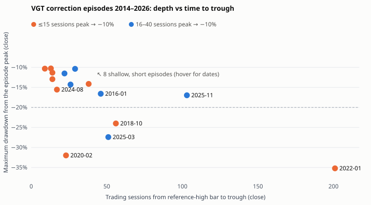

# Drawdown events: speed, depth and what the baseline did

All tables are generated by `src/drawdown-entry` (`results/episodes_full.csv`, `candidates_full.csv`, `signals_full.csv`; the development-only versions end in `_dev`). Prices are Stooq back-adjusted closes; "drawdown" is measured from the strategy's own reference high.

## Definitions

- **Reference high and signal (the baseline's):** highest intraday *high* of the 90 sessions before the decision session; signal when `1 − close / referenceHigh ≥ 10%`. A rolling 90-session peak, not an all-time high. Because it rolls, a decline older than 90 sessions is measured against a lower, more recent high.
- **Episode (unit for inference):** starts at the first signal while no episode is active; its peak P is that session's reference high, frozen; it ends at the first close ≥ P (full recovery), otherwise it is right-censored. Every later signal before recovery belongs to the same episode, so a correction with several entries counts once.
- **Velocity:** trading sessions (and calendar days) from the bar holding P to the first −10% close.
- **Severe (primary label):** a close ≤ 0.8 × P within 40 sessions of the first signal (the signal session included). Other depths/horizons are in the label grid. A window that runs past the data's end without reaching the level is censored, not "safe".
- **MAE from entry:** lowest *low* in the k sessions after a hypothetical entry at the signal close, as % of that close (≤ 0). This is a loss relative to the entry price, different from drawdown points relative to P.
- **Recovery** = close ≥ P. **Temporary bounce** = the largest close-to-close rally off the running low before the trough (`max_rally_before_trough` in the CSV). **Stabilization (ex post)** = first close after the trough that recovers 38% of P − trough (the baseline's reset fraction; `sessions_trough_to_retrace38`).
- **Candidates:** the first signal against each distinct reference-high bar; the unit the strategy decides on. In a long decline the 90-session high rolls off and new candidates appear with a velocity near 90: those reflect the window rolling, not how fast price fell.

## Sample size: the main limitation

**2014-01-02 → 2026-10-13 contains 15 independent episodes. Only 3 are severe by the primary label (2020-02, 2022-01, 2025-03), and 4 eventually fell ≥20% (adding 2018-10).** Development (2014–2022) has 10 episodes, 2 of them severe. No classifier accuracy can be established from this; every rate below has a confidence interval spanning most of [0, 1].

## Episode table, 2014–2026

<!-- table:episodes_full -->
| # | Peak | First −10% | Velocity (sess./cal. d) | Max DD (close) | Trough | Peak→trough | Recovery | −15/−20/−25/−30% ≤40 sess. | MAE 20 / 40 from entry | Baseline entries | Baseline P&L | Worst MTM |
| ---: | --- | --- | ---: | ---: | --- | ---: | --- | --- | ---: | ---: | ---: | ---: |
| 0 | 2015-07-20 | 2015-08-21 | 24 / 32 | 14.3% | 2015-08-25 | 26 | 2015-10-23 (44) | no / no / no / no | -23.2% / -23.2% | 2 | $1,126 | −$4,799 |
| 1 | 2015-12-02 | 2016-01-07 | 24 / 36 | 16.6% | 2016-02-09 | 46 | 2016-07-18 (132) | yes / no / no / no | -6.9% / -8.2% | 3 | −$6,531 | −$9,106 |
| 2 | 2018-01-26 | 2018-02-08 | 9 / 13 | 10.3% | 2018-02-08 | 9 | 2018-02-26 (11) | no / no / no / no | -1.7% / -1.7% | 1 | $5,395 | $0 |
| 3 | 2018-03-13 | 2018-04-02 | 13 / 20 | 10.3% | 2018-04-02 | 13 | 2018-06-01 (43) | no / no / no / no | -1.4% / -1.4% | 1 | $7,610 | $0 |
| 4 | 2018-10-03 | 2018-10-11 | 6 / 8 | 24.0% | 2018-12-24 | 56 | 2019-03-21 (109) | yes / no / no / no | -4.6% / -7.6% | 4 | $2,117 | −$13,976 |
| 5 | 2019-05-01 | 2019-06-03 | 22 / 33 | 11.5% | 2019-06-03 | 22 | 2019-07-03 (22) | no / no / no / no | 0.0% / 0.0% | 1 | $6,201 | $0 |
| 6 | 2020-02-19 | 2020-02-25 | 4 / 6 | 32.0% | 2020-03-23 | 23 | 2020-06-09 (73) | yes / yes / yes / yes | -26.7% / -26.7% | 4 | $44,155 | −$12,260 |
| 7 | 2020-09-02 | 2020-09-08 | 3 / 6 | 12.9% | 2020-09-23 | 14 | 2020-12-04 (62) | no / no / no / no | -2.6% / -2.6% | 2 | $11,254 | −$3,487 |
| 8 | 2021-02-16 | 2021-03-04 | 12 / 16 | 11.3% | 2021-03-08 | 14 | 2021-04-13 (27) | no / no / no / no | -2.1% / -2.1% | 1 | $1,830 | −$1,122 |
| 9 | 2021-12-28 | 2022-01-19 | 15 / 22 | 35.2% | 2022-10-14 | 201 | 2023-11-20 (462) | yes / yes / no / no | -8.6% / -12.1% | 14 | $43,328 | −$9,807 |
| 10 | 2024-03-08 | 2024-04-19 | 29 / 42 | 10.4% | 2024-04-19 | 29 | 2024-05-15 (18) | no / no / no / no | -0.1% / -0.1% | 1 | $14,049 | $0 |
| 11 | 2024-07-15 | 2024-08-01 | 13 / 17 | 15.5% | 2024-08-07 | 17 | 2024-10-29 (62) | yes / no / no / no | -9.7% / -9.7% | 1 | −$1,806 | −$6,217 |
| 12 | 2025-01-24 | 2025-03-03 | 25 / 38 | 27.4% | 2025-04-08 | 51 | 2025-06-25 (79) | yes / yes / yes / no | -8.8% / -21.9% | 3 | $34,557 | −$16,770 |
| 13 | 2025-10-29 | 2025-11-20 | 16 / 22 | 17.0% | 2026-03-30 | 103 | 2026-04-17 (100) | no / no / no / no | -1.8% / -1.8% | 3 | $28,891 | −$6,251 |
| 14 | 2026-06-03 | 2026-06-10 | 5 / 7 | 14.1% | 2026-07-29 | 38 | 2026-09-22 (71) | no / no / no / no | -0.1% / -3.8% | 2 | −$1,273 | −$4,933 |
<!-- /table -->

"Baseline P&L" is trade-based: every baseline trade whose signal falls in the episode window. "Worst MTM" is the worst fall of the baseline's mark-to-market inside the window, relative to the mark just before the first signal. The 2015-08 MAE of −23% is the 24 August 2015 opening dislocation in the daily low; the stop was not active and no trade filled there.

### How soon the deeper levels came

<!-- table:threshold_timing_full -->
| First −10% | Sessions to −15% | to −20% | to −25% | to −30% | Calendar days to −20% | Episode |
| --- | ---: | ---: | ---: | ---: | ---: | --- |
| 2015-08-21 | – | – | – | – | – | recovered |
| 2016-01-07 | 21 | – | – | – | – | recovered |
| 2018-02-08 | – | – | – | – | – | recovered |
| 2018-04-02 | – | – | – | – | – | recovered |
| 2018-10-11 | 28 | 49 | – | – | 71 | recovered |
| 2019-06-03 | – | – | – | – | – | recovered |
| 2020-02-25 | 9 | 9 | 12 | 14 | 13 | recovered |
| 2020-09-08 | – | – | – | – | – | recovered |
| 2021-03-04 | – | – | – | – | – | recovered |
| 2022-01-19 | 4 | 37 | 76 | 100 | 54 | recovered |
| 2024-04-19 | – | – | – | – | – | recovered |
| 2024-08-01 | 2 | – | – | – | – | recovered |
| 2025-03-03 | 5 | 23 | 24 | – | 31 | recovered |
| 2025-11-20 | 86 | – | – | – | – | recovered |
| 2026-06-10 | – | – | – | – | – | recovered |
<!-- /table -->

### Every depth × horizon (episodes reaching the depth / uncensored episodes)

<!-- table:label_grid_full -->
| Depth vs reference high | ≤10 sessions | ≤20 sessions | ≤40 sessions | ≤60 sessions |
| --- | ---: | ---: | ---: | ---: |
| −15% | 4/15 | 4/15 | 6/15 | 6/15 |
| −20% | 1/15 | 1/15 | 3/15 | 4/15 |
| −25% | 0/15 | 1/15 | 2/15 | 2/15 |
| −30% | 0/15 | 1/15 | 1/15 | 1/15 |
<!-- /table -->

**Q1 answer.** After the first −10% close, 6 of 15 episodes (40%) closed at −15% within 40 sessions, 3 (20%) at −20%, 2 at −25% and 1 at −30% (2020). Within 60 sessions, 4 reached −20% (2018-10 took 49 sessions). The fast ones were very fast: 2020 went from −10% to −30% in 14 sessions; 2025 went from −10% to −25% in 24 sessions after a slow start; 2022 needed 37 sessions to reach −20% and 100 to reach −30%.

## Depth versus time to trough

The deep episodes do not share a shape. 2020 was fast and deep (4 sessions to −10%, trough after 23). 2022 reached −10% in 15 sessions and then took 201 sessions to bottom. 2025 took 25 sessions to reach −10% and then fell to −27% within 51 sessions of the peak. 2018-10 was fast to −10% and slow to −24%.

## Velocity bins (hypothesis bins, not thresholds)

Episodes (one row each):

<!-- table:velocity_bins_episodes_full -->
| Velocity bin (sessions peak → −10%) | Episodes | ≥20% within 40 sessions | Eventually ≥20% | Deepest | Mean MAE 40 from entry | Worst MAE 40 | Baseline P&L in bin | Worst baseline MTM |
| --- | ---: | --- | ---: | ---: | ---: | ---: | ---: | ---: |
| ≤15 | 9 | 2/9 (22%; 95% 6%–55%) | 3/9 | 35.2% | -7.5% | -26.7% | $112,611 | −$13,976 |
| 16–40 | 6 | 1/6 (17%; 95% 3%–56%) | 1/6 | 27.4% | -9.2% | -23.2% | $78,294 | −$16,770 |
| >40 | 0 | – | 0/0 | – | – | – | $0 | $0 |
<!-- /table -->

Candidates (clustered by episode for the interval):

<!-- table:velocity_bins_candidates_full -->
| Velocity bin | Candidates (uncensored) | Episodes | ≥20% within 40 sessions | Mean further close drop ≤40 sess. | Worst |
| --- | ---: | ---: | --- | ---: | ---: |
| ≤15 | 10 | 9 | 3/10 (30%; cluster 95% 0%–64%) | -6.8% | -24.2% |
| 16–40 | 6 | 6 | 1/6 (17%; cluster 95% 0%–50%) | -5.0% | -18.6% |
| >40 | 17 | 2 | 10/17 (59%; cluster 95% 0%–67%) | -6.8% | -17.1% |
<!-- /table -->

**Q2 answer.** Severe rates are 2/9 for episodes that reached −10% within 15 sessions and 1/6 for 16–40 sessions. The intervals (6%–55% and 3%–56%) overlap almost completely, so **there is no evidence that velocity separates corrections that stabilise from ones that reach −20%**, in either direction. No primary episode took more than 40 sessions to reach −10%: with a 90-session rolling high, a slow decline either signals within that window or is re-measured from a lower high. The >40 candidates are almost all 2022's rolled-window signals; their 10/17 severe rate comes from essentially one episode (cluster interval 0%–67%). They do say "this decline is already months old", which is real information but not an early warning: by then the damage of the first entry is done.

Development period only (what the rules were designed on): ≤15 sessions 2/7 severe, 16–40 sessions 0/3 (`results/tables/velocity_bins_episodes_dev.md`). The 2025 crash (velocity 25) then landed in the bin that had looked safe.

## Pre-2014 external stress test (VGT 2006–2013; never used for selection)

<!-- table:stress_episodes_2006_2013 -->
| First −10% | Velocity | Max DD | Trough | ≥20% ≤40 sess. | Recovered |
| --- | ---: | ---: | --- | --- | --- |
| 2006-05-23 | 31 | 18.2% | 2006-07-21 | no | 2006-11-10 |
| 2007-11-12 | 8 | 54.8% | 2008-11-20 | no | 2011-01-18 |
| 2011-06-13 | 78 | 19.8% | 2011-08-19 | no | 2012-02-01 |
| 2012-05-17 | 31 | 13.7% | 2012-06-01 | no | 2012-09-14 |
| 2012-11-07 | 36 | 13.4% | 2012-11-15 | no | 2013-05-16 |
<!-- /table -->

<!-- table:threshold_timing_2006_2013 -->
| First −10% | Sessions to −15% | to −20% | to −25% | to −30% | Calendar days to −20% | Episode |
| --- | ---: | ---: | ---: | ---: | ---: | --- |
| 2006-05-23 | 14 | – | – | – | – | recovered |
| 2007-11-12 | 38 | 47 | 211 | 221 | 71 | recovered |
| 2011-06-13 | 39 | – | – | – | – | recovered |
| 2012-05-17 | – | – | – | – | – | recovered |
| 2012-11-07 | – | – | – | – | – | recovered |
<!-- /table -->

The full-recovery rule merges 2007–2010 into one episode (VGT recovered its 2007 peak only in January 2011). That episode reached −10% in 8 sessions and −20% after 47 sessions, so it is not "severe" by the 40-session label even though it ended at −55%. The 40-session label misses slow-building bear markets.

## Event, trade and strategy outcomes are different things

- **Event outcome:** whether VGT reached −20% after the first signal. 3 of 15.
- **Trade outcome:** the baseline's *first* trade in each severe episode lost, but not catastrophically, because the 15-day maximum hold sells a losing position at the open: 2020-02-25 lost $8,847 (its low was 12% below entry before the exit; VGT later fell 27% below that entry), 2022-01-19 lost $1,501, 2025-03-03 lost $3,025 and the 2025-03-28 re-entry lost $1,753 (low 17% below entry, sold at the 15-day open on 2025-04-14).
- **Strategy outcome:** the baseline's trades in each severe episode were **profitable in total**: 2020 +$44,155, 2022 (through its 2023 recovery) +$43,328, 2025 +$34,557. Re-entries after the material-loss restriction (3% below the loss exit) and the recovery reset bought much lower. The worst mark-to-market fall within any episode was −$16,770 (2025).

So the failure mode in the brief, buying $100k at −10% and watching VGT reach −20% to −25%, did happen three times. Each time the existing exits limited the first trade's loss to between $1.5k and $9k, and the episode as a whole made money.
