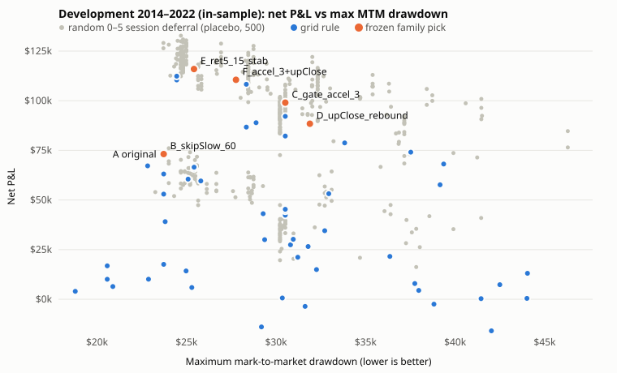
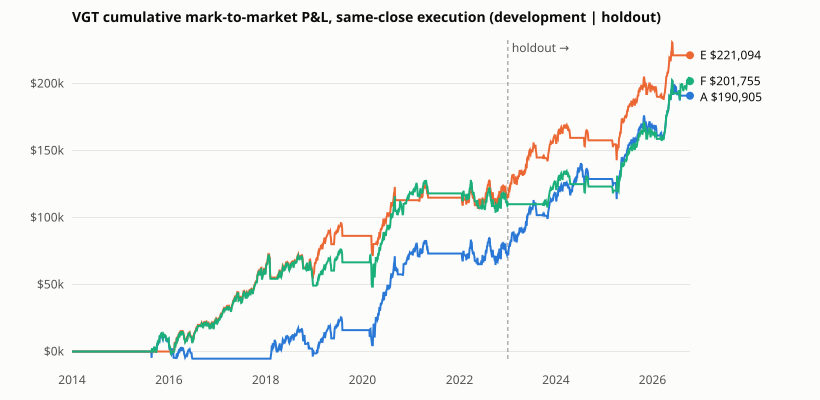

# Entry comparison: families A–F

Only the entry decision changes. After entry every rule uses the original's exits (15-calendar-day loss exit at the open, profit-conditional 8% trailing stop), sizing ($100,000 borrowed), 11% simple interest, the 0.5% / 3% / 38% material-loss restriction and reset, the one-position limit and the no-entry-on-an-exit-session rule. These are enforced by the engine for every policy (`src/drawdown-entry/engine.ts`; tested in `tests/engine.test.ts`).

## Shared state-machine semantics

- **Candidate** = the current reference-high bar once a 10% signal has occurred against it. Frozen attributes (velocity, regime at the first signal) are read at that first signal. A candidate ends when the reference-high bar changes (a new high, or the old high leaving the 90-session window). A new bar needs its own first signal.
- **Reject** = no entry against that candidate until it ends; there is no daily retrying.
- **Defer / wait** = re-evaluated at every close. For "zone" rules an entry still needs the original 10% signal on the entry session: a deferred signal stays eligible only while the close is ≥10% below the same reference high. **Rebound** rules (family D `_rebound`) may also enter after a confirmed stabilization while the close is ≥5% below the reference high; they are separate strategies.
- **Restriction** (after a ≥0.5% price-loss exit): any entry, including a rebound entry, also needs a close ≤ 97% of the loss-exit price and below the 38% reset level. A policy entry the restriction blocks is logged `…|blocked_by_restriction`.
- **Logging:** every session the policy evaluates while flat, and every signal session, is logged with the reason (`signal`, `reject_fast_v6`, `defer_accel_3`, `await_stabilization`, `below_15pct`, `stabilized_rebound`, `filled_next_open:…`, …). See `results/decisions_all_rules.csv` (all 58 rules + F, both executions, 2014–2026) and `results/decisions/<rule>_<execution>.csv` for the frozen rules.

## The rules (all pre-specified in `policies.ts` and PROTOCOL.md)

| Family | Rules | Exact behaviour |
|---|---|---|
| A | `A_original` | Enter on every 10% signal. |
| B velocity | `B_skipFast_{5,10,15,20}` | Reject the candidate if velocity ≤ V sessions. |
| | `B_skipSlow_{20,40,60}` | Reject the candidate if velocity > V. |
| | `B_deferFast_{10,15}_5` | If velocity ≤ V, wait until 5 sessions after the first signal (signal still required). |
| C deterioration | `C_gate_<flag>` (18) | Defer while the flag is raised at the close: ret5 ≤ −4/−6/−8%; accel5 ≤ −3/−5%; rv10/rv60 ≥ 1.5/2.0; ATR14 ≥ 3/4%; relVol20 ≥ 1.5/2.0; ≥60/80% of proxies ≥10% down; SPY ≥7/10% down; VIX(t−1) ≥ 25/30; ≥1 failed rally. |
| | `C_skip_{ret5_6, breadth_80, vix_30}` | Reject the candidate if the flag is raised at its first signal. |
| D stabilization | `D_<confirmation>_{zone,rebound}` (16) | After the first signal, enter only once: no new closing low for ≥2/3/5 sessions; close ≥2/3/5% above the lowest close; an up close; or rv10 below its value 5 sessions earlier plus no new low for ≥2 sessions. |
| E adaptive | `E_flat15`, `E_flat20` (+`_stab`) | Always require a 15% / 20% drawdown (and no new closing low for ≥2 sessions). |
| | `E_fast15`, `E_ret5_15` (+`_stab`) | Require 15% when velocity ≤15 / ret5 ≤ −6% at the first signal, otherwise 10%. |
| | `E_score`, `E_score_stab`, `E_score_skip` | Score = [ret5 ≤ −6%] + [≥80% proxies down 10%] + [rv10/rv60 ≥ 1.5] at the first signal: 0 → 10%, 1 → 15%, ≥2 → 20% (`_skip`: ≥2 → no entry; 1 → 15% + stabilization). |
| F combination | `F_<flag>+<stabilizer>` | Two stages. On a 10% signal: if the chosen C flag is raised, wait for the chosen D zone stabilizer; otherwise enter as A. The flag and stabilizer are each picked by the selection procedure. |

Percentages step in 0.1-point multiples and durations are whole sessions. The grid is deliberately small (58 rules + F). The Sobol/NSGA-II optimizer was **not** run.

## Development grid, 2014-01-02 → 2022-12-30 (in-sample, same-close)

J = net P&L − max MTM drawdown, the pre-registered selection objective. "Severe/deep episodes avoided": severe episodes (≥20% within 40 sessions) / deep episodes (≥20% eventually) in which the baseline entered before the trough and the rule did not.

<!-- table:grid_development -->
| Rule | Net P&L | Δ net vs A | Max MTM DD | Δ DD | Δ J | Entries | Severe-entry rate | Severe/deep episodes avoided | Missed winners | Exposure |
| --- | ---: | ---: | ---: | ---: | ---: | ---: | ---: | ---: | ---: | ---: |
| A_original | $72,993 | $0 | $23,723 | $0 | $0 | 30 | 57% | 0/2 · 0/3 | 0 | 979 |
| B_skipFast_5 | $17,584 | −$55,409 | $23,723 | $0 | −$55,409 | 24 | 54% | 1/2 · 1/3 | 3 | 759 |
| B_skipFast_10 | $10,071 | −$62,922 | $20,570 | −$3,153 | −$59,768 | 19 | 58% | 1/2 · 2/3 | 5 | 621 |
| B_skipFast_15 | $3,998 | −$68,995 | $18,785 | −$4,938 | −$64,058 | 10 | 40% | 1/2 · 2/3 | 9 | 322 |
| B_skipFast_20 | $3,998 | −$68,995 | $18,785 | −$4,938 | −$64,058 | 10 | 40% | 1/2 · 2/3 | 9 | 322 |
| B_skipSlow_20 | $65,724 | −$7,269 | $25,421 | +$1,698 | −$8,967 | 22 | 68% | 0/2 · 0/3 | 3 | 673 |
| B_skipSlow_40 | $66,520 | −$6,473 | $25,421 | +$1,698 | −$8,171 | 28 | 54% | 0/2 · 0/3 | 1 | 915 |
| B_skipSlow_60 | $73,136 | +$143 | $23,723 | $0 | +$143 | 30 | 57% | 0/2 · 0/3 | 0 | 978 |
| B_deferFast_10_5 | $42,349 | −$30,644 | $30,513 | +$6,790 | −$37,434 | 27 | 59% | 0/2 · 0/3 | 2 | 960 |
| B_deferFast_15_5 | $34,523 | −$38,470 | $32,716 | +$8,993 | −$47,463 | 25 | 64% | 0/2 · 0/3 | 4 | 783 |
| C_gate_ret5_4 | $82,206 | +$9,213 | $30,513 | +$6,790 | +$2,422 | 25 | 64% | 0/2 · 0/3 | 2 | 1259 |
| C_gate_ret5_6 | $92,125 | +$19,132 | $30,513 | +$6,790 | +$12,342 | 25 | 64% | 0/2 · 0/3 | 2 | 1285 |
| C_gate_ret5_8 | $44,462 | −$28,531 | $30,513 | +$6,790 | −$35,322 | 27 | 59% | 0/2 · 0/3 | 2 | 959 |
| C_gate_accel_3 | $99,022 | +$26,029 | $30,513 | +$6,790 | +$19,239 | 24 | 63% | 0/2 · 0/3 | 2 | 1264 |
| C_gate_accel_5 | $74,091 | +$1,098 | $37,522 | +$13,799 | −$12,700 | 24 | 63% | 0/2 · 0/3 | 2 | 1218 |
| C_gate_volRatio_15 | $60,511 | −$12,482 | $25,087 | +$1,364 | −$13,846 | 23 | 65% | 0/2 · 0/3 | 2 | 792 |
| C_gate_volRatio_20 | $59,588 | −$13,405 | $25,796 | +$2,073 | −$15,478 | 28 | 54% | 0/2 · 0/3 | 0 | 974 |
| C_gate_atr_30 | $39,089 | −$33,904 | $23,806 | +$83 | −$33,987 | 27 | 48% | 0/2 · 0/3 | 1 | 901 |
| C_gate_atr_40 | $52,956 | −$20,037 | $23,723 | $0 | −$20,037 | 28 | 50% | 0/2 · 0/3 | 1 | 955 |
| C_gate_relVol_15 | $53,168 | −$19,825 | $32,943 | +$9,220 | −$29,045 | 29 | 59% | 0/2 · 0/3 | 0 | 942 |
| C_gate_relVol_20 | $45,316 | −$27,677 | $30,513 | +$6,790 | −$34,468 | 28 | 57% | 0/2 · 0/3 | 1 | 965 |
| C_gate_breadth_60 | $10,102 | −$62,891 | $22,875 | −$848 | −$62,043 | 10 | 20% | 1/2 · 1/3 | 6 | 392 |
| C_gate_breadth_80 | $5,918 | −$67,075 | $25,294 | +$1,571 | −$68,646 | 21 | 40% | 0/2 · 0/3 | 1 | 658 |
| C_gate_spyDd_7 | $6,417 | −$66,576 | $20,883 | −$2,840 | −$63,736 | 9 | 56% | 1/2 · 1/3 | 7 | 231 |
| C_gate_spyDd_10 | $651 | −$72,342 | $30,349 | +$6,626 | −$78,968 | 20 | 50% | 0/2 · 0/3 | 3 | 627 |
| C_gate_vix_25 | −$15,903 | −$88,896 | $42,025 | +$18,301 | −$107,197 | 20 | 50% | 1/2 · 1/3 | 4 | 622 |
| C_gate_vix_30 | −$3,595 | −$76,588 | $31,619 | +$7,896 | −$84,484 | 26 | 54% | 0/2 · 0/3 | 3 | 750 |
| C_gate_failedRally_1 | −$13,928 | −$86,921 | $29,182 | +$5,459 | −$92,381 | 9 | 44% | 0/2 · 0/3 | 10 | 189 |
| C_skip_ret5_6 | $16,833 | −$56,160 | $20,570 | −$3,153 | −$53,007 | 14 | 79% | 1/2 · 2/3 | 6 | 430 |
| C_skip_breadth_80 | $66,520 | −$6,473 | $25,421 | +$1,698 | −$8,171 | 28 | 54% | 0/2 · 0/3 | 1 | 915 |
| C_skip_vix_30 | $63,095 | −$9,897 | $23,723 | $0 | −$9,897 | 28 | 61% | 0/2 · 0/3 | 1 | 895 |
| D_noNewLow_2_zone | $14,955 | −$58,038 | $32,257 | +$8,534 | −$66,572 | 23 | 70% | 0/2 · 0/3 | 4 | 728 |
| D_noNewLow_2_rebound | $57,662 | −$15,331 | $39,158 | +$15,435 | −$30,766 | 29 | 59% | 0/2 · 0/3 | 1 | 1187 |
| D_noNewLow_3_zone | $21,577 | −$51,416 | $36,355 | +$12,632 | −$64,048 | 19 | 68% | 0/2 · 0/3 | 4 | 693 |
| D_noNewLow_3_rebound | $4,455 | −$68,538 | $37,968 | +$14,245 | −$82,783 | 26 | 54% | 0/2 · 0/3 | 1 | 736 |
| D_noNewLow_5_zone | $27,436 | −$45,557 | $30,805 | +$7,082 | −$52,639 | 19 | 74% | 0/2 · 0/3 | 4 | 588 |
| D_noNewLow_5_rebound | $26,567 | −$46,426 | $31,789 | +$8,066 | −$54,491 | 24 | 58% | 0/2 · 0/3 | 2 | 807 |
| D_rebound_2_zone | $21,161 | −$51,832 | $31,212 | +$7,489 | −$59,321 | 20 | 70% | 0/2 · 0/3 | 5 | 645 |
| D_rebound_2_rebound | −$2,465 | −$75,458 | $38,816 | +$15,092 | −$90,550 | 27 | 56% | 0/2 · 0/3 | 1 | 763 |
| D_rebound_3_zone | $30,218 | −$42,775 | $30,959 | +$7,236 | −$50,011 | 19 | 74% | 0/2 · 0/3 | 4 | 634 |
| D_rebound_3_rebound | $312 | −$72,681 | $41,448 | +$17,725 | −$90,406 | 27 | 56% | 0/2 · 0/3 | 1 | 779 |
| D_rebound_5_zone | $7,344 | −$65,649 | $42,495 | +$18,772 | −$84,421 | 15 | 87% | 0/2 · 0/3 | 6 | 419 |
| D_rebound_5_rebound | $7,915 | −$65,078 | $37,747 | +$14,024 | −$79,102 | 21 | 62% | 0/2 · 0/3 | 2 | 650 |
| D_upClose_zone | $68,116 | −$4,877 | $39,358 | +$15,635 | −$20,512 | 21 | 67% | 0/2 · 0/3 | 6 | 1036 |
| D_upClose_rebound | $88,411 | +$15,418 | $31,887 | +$8,164 | +$7,254 | 30 | 53% | 0/2 · 0/3 | 0 | 1368 |
| D_volContract_zone | $13,078 | −$59,915 | $44,039 | +$20,316 | −$80,231 | 16 | 73% | 1/2 · 1/3 | 4 | 368 |
| D_volContract_rebound | $443 | −$72,550 | $44,008 | +$20,285 | −$92,835 | 23 | 55% | 1/2 · 1/3 | 2 | 693 |
| E_flat15 | $88,922 | +$15,929 | $28,884 | +$5,161 | +$10,769 | 15 | 87% | 0/2 · 0/3 | 6 | 883 |
| E_flat15_stab | $78,746 | +$5,753 | $33,830 | +$10,107 | −$4,353 | 13 | 85% | 0/2 · 0/3 | 6 | 802 |
| E_flat20 | $14,256 | −$58,737 | $24,974 | +$1,251 | −$59,988 | 9 | 100% | 0/2 · 0/3 | 7 | 212 |
| E_flat20_stab | $67,192 | −$5,800 | $22,826 | −$897 | −$4,904 | 7 | 100% | 0/2 · 1/3 | 7 | 275 |
| E_fast15 | $43,093 | −$29,900 | $29,277 | +$5,554 | −$35,454 | 22 | 68% | 0/2 · 0/3 | 4 | 667 |
| E_fast15_stab | $30,019 | −$42,974 | $29,362 | +$5,639 | −$48,612 | 19 | 63% | 0/2 · 0/3 | 4 | 590 |
| E_ret5_15 | $110,463 | +$37,470 | $24,450 | +$727 | +$36,743 | 20 | 75% | 0/2 · 0/3 | 3 | 1148 |
| E_ret5_15_stab | $115,958 | +$42,965 | $25,415 | +$1,692 | +$41,273 | 20 | 75% | 0/2 · 0/3 | 3 | 1150 |
| E_score | $112,358 | +$39,365 | $24,450 | +$727 | +$38,637 | 17 | 76% | 0/2 · 0/3 | 4 | 1086 |
| E_score_stab | $108,276 | +$35,284 | $28,338 | +$4,615 | +$30,669 | 17 | 76% | 0/2 · 1/3 | 4 | 1040 |
| E_score_skip | $86,715 | +$13,722 | $28,338 | +$4,615 | +$9,107 | 16 | 75% | 0/2 · 1/3 | 5 | 951 |
| F_ret5_6+upClose | $111,029 | +$38,036 | $27,760 | +$4,037 | +$34,000 | 28 | 64% | 0/2 · 0/3 | 1 | 1370 |
| F_accel_3+upClose | $110,537 | +$37,544 | $27,760 | +$4,037 | +$33,508 | 28 | 64% | 0/2 · 0/3 | 1 | 1360 |
<!-- /table -->

11 of 57 rules beat A on J in development; none of them does so in both development and the holdout (below).

Profit versus drawdown in development. Grey: 500 *uninformed* random deferrals of 0–5 sessions. **The cloud of random deferrals covers the frozen picks.** Their median beats A by +$20k on J, because a one-to-five-day shift often catches the February 2016 → February 2018 hold (+$55k), which A missed by entering on 2016-02-26 and being stopped out by the maximum hold. On development the frozen picks' ΔJ sits at the 30th–73rd percentile of that placebo distribution (ROBUSTNESS.md).

## Frozen picks: the required summary tables

"Best validated" in the brief's table means the family's frozen pick. **None of them passed validation** (ROBUSTNESS.md). Severe-entry rate = entries whose reference high is breached by 20% within 40 sessions of the signal (uncensored entries); it rises mechanically for rules that buy deeper. "Severe episodes avoided" = severe episodes where A entered before the trough and the rule did not. "Profitable entries missed" = A's winning trades the rule never overlapped. Exposure = sessions closing with a position.

### Development 2014–2022, same-close (in-sample: the picks were chosen here)

<!-- table:summary_development_close -->
| Approach | Net P&L | Margin interest | Max MTM drawdown | Trades | Severe-entry rate | Severe episodes avoided | Profitable entries missed | Exposure days |
| --- | ---: | ---: | ---: | ---: | ---: | ---: | ---: | ---: |
| A — Original | $72,993 | $42,644 | $23,723 | 30 | 57% (17/30) | 0/2 | 0 | 979 |
| B — Velocity gate: B_skipSlow_60 | $73,136 | $42,644 | $23,723 | 30 | 57% (17/30) | 0/2 | 0 | 978 |
| C — Deterioration gate: C_gate_accel_3 | $99,022 | $55,301 | $30,513 | 24 | 63% (15/24) | 0/2 | 2 | 1264 |
| D — Stabilization confirmation: D_upClose_rebound | $88,411 | $59,701 | $31,887 | 30 | 53% (16/30) | 0/2 | 0 | 1368 |
| E — Adaptive threshold: E_ret5_15_stab | $115,958 | $50,118 | $25,415 | 20 | 75% (15/20) | 0/2 | 3 | 1150 |
| F — Simple combination: F_accel_3+upClose | $110,537 | $59,400 | $27,760 | 28 | 64% (18/28) | 0/2 | 1 | 1360 |
<!-- /table -->

### Holdout 2023-01-03 → 2026-10-13, same-close (out-of-sample, run once after freezing)

<!-- table:summary_holdout_close -->
| Approach | Net P&L | Margin interest | Max MTM drawdown | Trades | Severe-entry rate | Severe episodes avoided | Profitable entries missed | Exposure days |
| --- | ---: | ---: | ---: | ---: | ---: | ---: | ---: | ---: |
| A — Original | $117,912 | $30,107 | $28,687 | 13 | 23% (3/13) | 0/1 | 0 | 680 |
| B — Velocity gate: B_skipSlow_60 | $58,812 | $21,427 | $28,687 | 11 | 27% (3/11) | 0/1 | 2 | 482 |
| C — Deterioration gate: C_gate_accel_3 | $47,807 | $13,441 | $23,163 | 8 | 25% (2/8) | 0/1 | 1 | 308 |
| D — Stabilization confirmation: D_upClose_rebound | $99,324 | $29,534 | $19,248 | 15 | 23% (3/13) | 0/1 | 0 | 671 |
| E — Adaptive threshold: E_ret5_15_stab | $105,136 | $25,858 | $28,753 | 10 | 30% (3/10) | 0/1 | 1 | 586 |
| F — Simple combination: F_accel_3+upClose | $91,217 | $21,849 | $17,801 | 10 | 30% (3/10) | 0/1 | 1 | 499 |
<!-- /table -->

### Full period 2014–2026, same-close

<!-- table:summary_full_close -->
| Approach | Net P&L | Margin interest | Max MTM drawdown | Trades | Severe-entry rate | Severe episodes avoided | Profitable entries missed | Exposure days |
| --- | ---: | ---: | ---: | ---: | ---: | ---: | ---: | ---: |
| A — Original | $190,905 | $72,751 | $28,687 | 43 | 47% (20/43) | 0/3 | 0 | 1659 |
| B — Velocity gate: B_skipSlow_60 | $131,948 | $64,071 | $28,687 | 41 | 49% (20/41) | 0/3 | 2 | 1460 |
| C — Deterioration gate: C_gate_accel_3 | $146,829 | $68,742 | $30,513 | 32 | 53% (17/32) | 0/3 | 3 | 1572 |
| D — Stabilization confirmation: D_upClose_rebound | $187,735 | $89,236 | $31,887 | 45 | 44% (19/43) | 0/3 | 0 | 2039 |
| E — Adaptive threshold: E_ret5_15_stab | $221,094 | $75,975 | $28,753 | 30 | 60% (18/30) | 0/3 | 4 | 1736 |
| F — Simple combination: F_accel_3+upClose | $201,755 | $81,249 | $27,760 | 38 | 55% (21/38) | 0/3 | 2 | 1859 |
<!-- /table -->

Warm-start A over the full period ($190,905, 43 trades) equals the original run cold from 2014-01-02 (golden-master case `VGT-2014-start`).

### Executable sensitivity: next-session open (not blended with the above)

Development:

<!-- table:summary_development_nextOpen -->
| Approach | Net P&L | Margin interest | Max MTM drawdown | Trades | Severe-entry rate | Severe episodes avoided | Profitable entries missed | Exposure days |
| --- | ---: | ---: | ---: | ---: | ---: | ---: | ---: | ---: |
| A — Original | $103,001 | $55,211 | $31,684 | 28 | 61% (17/28) | 0/2 | 0 | 1267 |
| B — Velocity gate: B_skipSlow_60 | $94,671 | $53,795 | $31,684 | 27 | 59% (16/27) | 0/2 | 0 | 1232 |
| C — Deterioration gate: C_gate_accel_3 | $89,045 | $51,625 | $31,787 | 25 | 68% (17/25) | 0/2 | 2 | 1182 |
| D — Stabilization confirmation: D_upClose_rebound | $99,670 | $55,995 | $30,522 | 28 | 57% (16/28) | 0/2 | 0 | 1288 |
| E — Adaptive threshold: E_ret5_15_stab | $69,203 | $43,879 | $27,280 | 20 | 75% (15/20) | 0/2 | 2 | 1008 |
| F — Simple combination: F_accel_3+upClose | $113,411 | $55,151 | $30,198 | 26 | 65% (17/26) | 0/2 | 2 | 1261 |
<!-- /table -->

Holdout:

<!-- table:summary_holdout_nextOpen -->
| Approach | Net P&L | Margin interest | Max MTM drawdown | Trades | Severe-entry rate | Severe episodes avoided | Profitable entries missed | Exposure days |
| --- | ---: | ---: | ---: | ---: | ---: | ---: | ---: | ---: |
| A — Original | $130,265 | $36,888 | $25,780 | 14 | 21% (3/14) | 0/1 | 0 | 840 |
| B — Velocity gate: B_skipSlow_60 | $67,656 | $28,389 | $25,780 | 12 | 25% (3/12) | 0/1 | 2 | 646 |
| C — Deterioration gate: C_gate_accel_3 | $100,609 | $25,797 | $18,747 | 8 | 25% (2/8) | 0/1 | 2 | 590 |
| D — Stabilization confirmation: D_upClose_rebound | $91,858 | $28,329 | $21,054 | 13 | 18% (2/11) | 0/1 | 1 | 643 |
| E — Adaptive threshold: E_ret5_15_stab | $109,071 | $31,071 | $25,780 | 11 | 27% (3/11) | 0/1 | 2 | 705 |
| F — Simple combination: F_accel_3+upClose | $75,747 | $21,518 | $19,631 | 9 | 22% (2/9) | 0/1 | 3 | 492 |
<!-- /table -->

The executable convention alone moves A by +$30k in development (it happens to catch the 2016–2018 hold) and +$12k in the holdout. That is the scale of pure timing noise. Under next-open fills every frozen pick except F (development) loses to A, and all five lose in the holdout.

### Decisions on candidate signals

<!-- table:decision_counts -->
| Rule | Execution | Window | Candidates faced while flat | Entered | Deferred, then entered | Rejected | Never entered | Severe-entry rate 20 / 25 / 30% | Entries followed by a further ≥10% close drop (≤40 sess.) |
| --- | --- | --- | ---: | ---: | ---: | ---: | ---: | ---: | ---: |
| A_original | close | development | 15 | 14 | 0 | 0 | 1 | 57% / 23% / 13% | 18% |
| B_skipSlow_60 | close | development | 19 | 12 | 0 | 7 | 7 | 57% / 23% / 10% | 21% |
| C_gate_accel_3 | close | development | 16 | 14 | 9 | 0 | 2 | 63% / 21% / 8% | 27% |
| D_upClose_rebound | close | development | 14 | 13 | 13 | 0 | 1 | 53% / 23% / 10% | 25% |
| E_ret5_15_stab | close | development | 16 | 11 | 3 | 0 | 5 | 75% / 20% / 10% | 28% |
| F_accel_3+upClose | close | development | 14 | 13 | 9 | 0 | 1 | 64% / 25% / 11% | 27% |
| A_original | close | holdout | 8 | 8 | 0 | 0 | 0 | 23% / 15% / 0% | 15% |
| B_skipSlow_60 | close | holdout | 9 | 6 | 0 | 3 | 3 | 27% / 18% / 0% | 18% |
| C_gate_accel_3 | close | holdout | 7 | 6 | 6 | 0 | 1 | 25% / 13% / 0% | 13% |
| D_upClose_rebound | close | holdout | 10 | 7 | 7 | 0 | 3 | 23% / 15% / 0% | 8% |
| E_ret5_15_stab | close | holdout | 8 | 6 | 0 | 0 | 2 | 30% / 20% / 0% | 20% |
| F_accel_3+upClose | close | holdout | 9 | 6 | 6 | 0 | 3 | 30% / 20% / 0% | 10% |
| A_original | nextOpen | development | 14 | 13 | 0 | 0 | 1 | 61% / 25% / 11% | 23% |
| B_skipSlow_60 | nextOpen | development | 14 | 12 | 0 | 2 | 2 | 59% / 26% / 11% | 24% |
| C_gate_accel_3 | nextOpen | development | 15 | 13 | 8 | 0 | 2 | 68% / 24% / 12% | 30% |
| D_upClose_rebound | nextOpen | development | 14 | 13 | 13 | 0 | 1 | 57% / 25% / 11% | 23% |
| E_ret5_15_stab | nextOpen | development | 14 | 10 | 3 | 0 | 4 | 75% / 25% / 10% | 28% |
| F_accel_3+upClose | nextOpen | development | 14 | 12 | 8 | 0 | 2 | 65% / 27% / 12% | 29% |
| A_original | nextOpen | holdout | 8 | 8 | 0 | 0 | 0 | 21% / 14% / 0% | 14% |
| B_skipSlow_60 | nextOpen | holdout | 9 | 6 | 0 | 3 | 3 | 25% / 17% / 0% | 17% |
| C_gate_accel_3 | nextOpen | holdout | 7 | 6 | 5 | 0 | 1 | 25% / 13% / 0% | 13% |
| D_upClose_rebound | nextOpen | holdout | 9 | 7 | 7 | 0 | 2 | 18% / 18% / 0% | 9% |
| E_ret5_15_stab | nextOpen | holdout | 8 | 6 | 0 | 0 | 2 | 27% / 18% / 0% | 18% |
| F_accel_3+upClose | nextOpen | holdout | 8 | 6 | 5 | 0 | 2 | 22% / 22% / 0% | 11% |
<!-- /table -->

Counts are per candidate the rule faced while flat (a rule in a position does not face the candidate). The last column is the share of entries followed within 40 sessions by a close ≥10% below the entry price, the direct form of the brief's failure mode. Deferral did not lower it in development (A 18%, picks 21–28%). In the holdout, D and F lowered it (8% and 10% vs 15%), but on a dozen entries.

## Episode-by-episode attribution (2014–2026, same-close)

Each trade's P&L belongs to the episode containing its signal. "Worst MTM" is the worst fall of the rule's mark within the episode window.

<!-- table:attribution_full -->
| Episode (first −10%) | Max DD | Severe | A trades P&L | A worst MTM | B Δ P&L / worst MTM | C Δ P&L / worst MTM | D Δ P&L / worst MTM | E Δ P&L / worst MTM | F Δ P&L / worst MTM |
| --- | ---: | --- | ---: | ---: | ---: | ---: | ---: | ---: | ---: |
| 2015-08-21 | 14.3% | no | $1,126 | −$4,799 | $0 / −$4,799 | −$1,251 / −$472 | −$1,482 / −$1,633 | −$1,126 / $0 | +$644 / −$1,633 |
| 2016-01-07 | 16.6% | no | −$6,531 | −$9,106 | $0 / −$9,106 | +$57,112 / −$3,822 | +$58,985 / −$6,018 | +$61,714 / $0 | +$58,985 / −$6,063 |
| 2018-02-08 | 10.3% | no | $5,395 | $0 | $0 / $0 | −$5,395 / $0 | −$2,484 / $0 | −$5,395 / $0 | −$5,395 / $0 |
| 2018-04-02 | 10.3% | no | $7,610 | $0 | $0 / $0 | $0 / $0 | −$986 / −$801 | $0 / $0 | $0 / $0 |
| 2018-10-11 | 24.0% | no | $2,117 | −$13,976 | $0 / −$13,976 | −$1,012 / −$14,049 | −$772 / −$14,457 | +$15,141 / −$10,922 | −$3,626 / −$13,292 |
| 2019-06-03 | 11.5% | no | $6,201 | $0 | $0 / $0 | $0 / $0 | −$3,462 / $0 | $0 / $0 | $0 / $0 |
| 2020-02-25 | 32.0% | yes | $44,155 | −$12,260 | $0 / −$12,260 | −$25,509 / −$20,933 | −$10,693 / −$22,604 | −$17,472 / −$15,834 | −$5,840 / −$18,179 |
| 2020-09-08 | 12.9% | no | $11,254 | −$3,487 | $0 / −$3,487 | +$77 / −$3,491 | −$8,228 / −$10,987 | −$11,254 / $0 | +$77 / −$3,491 |
| 2021-03-04 | 11.3% | no | $1,830 | −$1,122 | $0 / −$1,122 | $0 / −$1,122 | −$4,573 / −$2,671 | $0 / −$1,122 | $0 / −$1,122 |
| 2022-01-19 | 35.2% | yes | $43,328 | −$9,807 | −$27,863 / −$9,734 | −$29,476 / −$9,741 | −$39,960 / −$17,311 | +$1,357 / −$8,450 | −$36,374 / −$14,523 |
| 2024-04-19 | 10.4% | no | $14,049 | $0 | $0 / $0 | −$14,049 / $0 | −$1,496 / $0 | −$14,049 / $0 | −$14,049 / $0 |
| 2024-08-01 | 15.5% | no | −$1,806 | −$6,217 | $0 / −$6,217 | $0 / −$6,217 | +$10,089 / −$1,192 | $0 / −$6,217 | $0 / −$6,217 |
| 2025-03-03 | 27.4% | yes | $34,557 | −$16,770 | $0 / −$16,770 | −$40,051 / −$11,261 | −$793 / −$7,708 | $0 / −$16,770 | +$1,145 / −$5,820 |
| 2025-11-20 | 17.0% | no | $28,891 | −$6,251 | −$31,094 / −$3,670 | +$5,064 / −$2,007 | +$712 / −$1,714 | $0 / −$6,251 | +$4,870 / −$2,201 |
| 2026-06-10 | 14.1% | no | −$1,273 | −$4,933 | $0 / −$4,933 | +$10,413 / −$4,714 | +$1,974 / −$5,881 | +$1,273 / $0 | +$10,413 / −$4,714 |
<!-- /table -->

## What the frozen picks did in the crashes (human-readable)

- **B_skipSlow_60** (reject a candidate whose first signal came >60 sessions after its peak). It never fires on an episode's first signal: none took >40 sessions. It fires only on rolled-window candidates late in long declines. Identical to A in 2020 and 2025-03. It cost $27.9k in the 2022 episode, mostly by rejecting the rolled candidate behind A's 2023-01-04 entry (+$28,006), and $31.1k in the 2025-11 episode by rejecting the rolled candidate behind A's 2026-03-26 entry (+$31,094). Late, rolled-window signals in a long decline were some of A's best entries.
- **C_gate_accel_3** (defer while the last 5 sessions fell ≥3 points more than the 5 before). In 2020 it waited through the first leg and bought on 2020-03-03 at −12.7%. The 15-day exit sold on 2020-03-18 for **−$20,933**, against A's −$8,847 on its first trade. It re-entered on 2020-04-07 for +$39,579 (A: +$48,014 from 2020-04-02). 2022 was the same as A. In 2025 it was holding a 2025-04-09 entry (−$2,469) when A bought on 2025-04-16, so it missed A's +$39,335 trade (episode −$40,051).
- **D_upClose_rebound** (after a first signal, buy the first up close while ≥5% down). 2020: bought 2020-02-26 at −10.0%, sold on 2020-03-12 for **−$17,601**. 2025: bought on 2025-03-05 above the 10% line (−9.5%) and lost $4,963, then bought the 2025-04-07 up close at −25.9% (+$3,014) and 2025-04-11 (+$35,713). It had the lowest holdout drawdown of the picks ($19,248 vs $28,687).
- **E_ret5_15_stab** (if ret5 ≤ −6% at the first signal, require −15% plus 2 sessions without a new low). 2016: waited until 2016-02-11 and caught the two-year hold (+$55,184; this one trade is its whole development edge). 2020: entered 2020-03-11 at −19.5% and lost $5,998, then entered 2020-04-15 for +$32,682 (A: +$48,014). In 2022 and 2025 it behaved exactly as A. The 2025-03-03 first signal had ret5 = −5.96%, just short of the −6% flag. In 2024-04 it required −15%, which never came, and it missed A's +$14,049.
- **F_accel_3 + upClose** (if accel5 ≤ −3% on a signal, wait for an up close). 2020: entered 2020-02-28 at −13.9% and lost **−$18,179**. 2025: the flag forced a wait into 2025-04-07/11; its holdout drawdown was the lowest of all ($17,801), and its holdout net was $26.7k below A.

**Q5 answer (do deferred entries reduce exposure or just enter later?).** In the crash that matters most, 2020, every deferral rule entered *later and lower but still before the bottom*. Because the 15-day maximum hold is unchanged, the first loss got bigger, not smaller ($17.6k–$20.9k vs $8.8k). Deferral helped when it moved the entry past the trough (2016, and D/F in 2025). That depends on how long the decline lasts, which no indicator here predicts. Over the full period the picks missed 0–4 of A's 17 profitable entries.

## Cumulative P&L

E's lead over A comes from 2016 (one trade). In the holdout, E and F trail A, and A catches up.

## Financing

For A, interest equals 37% of pre-interest profit in development and 20% in the holdout. In development, rules that hold longer pay more: D +$17.1k, F +$16.8k and C +$12.7k more interest than A, whose development interest is $42,644. Margin-rate sensitivities (8%, 14%) are in ROBUSTNESS.md. They do not change any sign.
